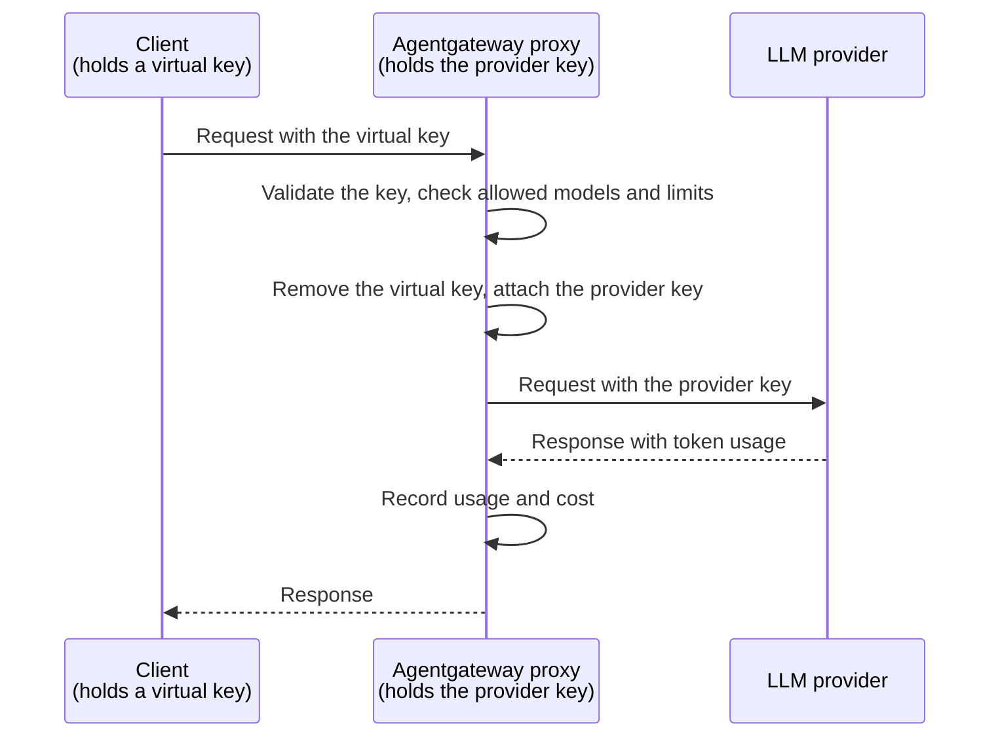

Keep LLM provider API keys on . Give each client a revocable virtual key.

## About

When clients use a provider API key directly, each laptop, CI runner, or workspace stores a copy. Rotating the key means finding and replacing every copy.

With , provider keys stay in Kubernetes Secrets. Clients receive virtual keys that work only with the proxy. You can revoke each virtual key independently.



The provider never receives the virtual key, and the client never receives the provider key. Manage access in the cluster without reconfiguring clients:

| Task | Change in the cluster |
| -- | -- |
| Rotate a provider key | Update the Secret that holds it. |
| Revoke a client | Remove its virtual key from the ConfigMap. Its next request gets a `401` response. |
| Limit usage of a copied virtual key | Set a token budget for each key. |
| Restrict model access | Add an authorization rule for the requested model. |

### More security considerations

All clients depend on the provider key in the Secret. Protect it as you would any other production credential.

* **Restrict who can read the Secret.** Limit the Kubernetes RBAC permissions to read Secrets in the namespace of the .
* **Encrypt client traffic.** Virtual keys are bearer credentials. Serve clients over [HTTPS](), or keep the Gateway on a private network.
* **Keep  up to date** with security patches.

## Before you begin



The OpenAI provider guide creates the `openai-secret` Secret and an `openai` . The  references the Secret in `policies.auth.secretRef`.

Use the HTTPRoute that matches all paths to allow requests to `/v1/chat/completions`. For other ways to provide the key, see [Provider API keys]().

## Step 1: Create virtual keys

Store a SHA-256 hash of each virtual key in a ConfigMap. The proxy hashes each incoming key and compares it to the stored hash. You do not need to store raw virtual keys in the cluster.

1. Generate a hash for each virtual key. This example creates keys for Alice and Bob. Do not include a trailing newline.

   ```sh
   printf '%s' 'vk-alice-4f9c2a' | sha256sum | awk '{print "sha256:"$1}'   # alice
   printf '%s' 'vk-bob-8d1e7b' | sha256sum | awk '{print "sha256:"$1}'     # bob
   ```

2. Create a ConfigMap with the hash and metadata of each key. The label lets the authentication policy in the next step select the ConfigMap.

   ```yaml
   kubectl apply -f- <<EOF
   apiVersion: v1
   kind: ConfigMap
   metadata:
     name: llm-api-keys
     namespace: 
     labels:
       agentgateway.dev/apikey: "true"
   data:
     alice: |
       {
         "keyHash": "sha256:84d589f2439e4d9ff4438aa840e63ffcbf231a87e7fef929f975d2bde03dc78c",
         "metadata": {
           "user_id": "alice"
         }
       }
     bob: |
       {
         "keyHash": "sha256:8373319fb10e2e023343d98ade630529f49c53f567cbc6626d09aaf650b2e58c",
         "metadata": {
           "user_id": "bob"
         }
       }
   EOF
   ```

## Step 2: Require virtual keys and allow only some models

Create an  to require virtual keys and restrict model access. Put both settings in one policy. If two policies target the same Gateway, one policy silently overwrites the other.

```yaml
kubectl apply -f- <<EOF
apiVersion: 
kind: 
metadata:
  name: api-key-auth
  namespace: 
spec:
  targetRefs:
    - group: gateway.networking.k8s.io
      kind: Gateway
      name: agentgateway-proxy
  traffic:
    apiKeyAuthentication:
      mode: Strict
      configMapSelector:
        matchLabels:
          agentgateway.dev/apikey: "true"
    authorization:
      action: Require
      policy:
        matchExpressions:
          - 'request.method != "POST" || json(request.body).model in ["gpt-4o-mini", "gpt-4o"]'
EOF
```

{}

| Setting | Description |
| -- | -- |
| `apiKeyAuthentication.mode` | Set to `Strict` so that every request needs a valid virtual key. |
| `configMapSelector` | Selects the ConfigMaps that hold the virtual keys. |
| `authorization.action` | Set to `Require` to reject requests with a `403` response unless the expression is true. |
| `matchExpressions` | Allows `POST` requests only for the listed models. Allows other methods, such as `GET` to list models. |

To set model access per user, combine the model expression with a check on the key metadata, such as `apiKey.user_id == "bob"`.

## Step 3: Connect a client with a virtual key

Configure your client with its virtual key and the Gateway base URL, such as `http://$INGRESS_GW_ADDRESS/v1`.

For client-specific instructions, see [OpenCode](), [Codex](), or [other LLM clients]().

If you use port-forwarding instead of a LoadBalancer address, replace `$INGRESS_GW_ADDRESS` with `localhost:8080` in the following requests.

1. Send a request with Alice's virtual key. The request succeeds.

   ```sh
   curl -s "$INGRESS_GW_ADDRESS/v1/chat/completions" \
     -H "Authorization: Bearer vk-alice-4f9c2a" \
     -H "Content-Type: application/json" \
     -d '{"model": "gpt-4o-mini", "messages": [{"role": "user", "content": "Hello!"}]}' | jq .
   ```

2. Request an unlisted model, such as `o3`. The proxy returns `403`, even if the provider key allows that model.

   ```sh
   curl -s -w "\n%{http_code}\n" "$INGRESS_GW_ADDRESS/v1/chat/completions" \
     -H "Authorization: Bearer vk-alice-4f9c2a" \
     -H "Content-Type: application/json" \
     -d '{"model": "o3", "messages": [{"role": "user", "content": "Hello!"}]}'
   ```

   Example output:

   ```
   authorization failed
   403
   ```

3. Send a request with an unknown key. The proxy returns `401`.

   ```sh
   curl -s -w "\n%{http_code}\n" "$INGRESS_GW_ADDRESS/v1/chat/completions" \
     -H "Authorization: Bearer vk-unknown" \
     -H "Content-Type: application/json" \
     -d '{"model": "gpt-4o-mini", "messages": [{"role": "user", "content": "Hello!"}]}'
   ```

   Example output:

   ```
   api key authentication failure: invalid credentials
   401
   ```

## Step 4: Rotate and revoke keys

Make the following changes in the cluster. You do not need to restart the proxy or change the configuration of any client.

* **Rotate the provider key**: Update the Secret with the new key. The proxy sends the new key with subsequent requests. After you verify that requests still succeed, revoke the old key in the console of your provider.

  ```sh
  kubectl create secret generic openai-secret -n  \
    --from-literal=Authorization="$NEW_OPENAI_API_KEY" \
    --dry-run=client -o yaml | kubectl apply -f -
  ```

* **Revoke a virtual key**: Remove the key from the ConfigMap. The next request with that key gets a `401` response.

  ```sh
  kubectl patch configmap llm-api-keys -n  \
    --type=json -p='[{"op": "remove", "path": "/data/bob"}]'
  ```

  Then send a request with Bob's key.

  ```sh
  curl -s -o /dev/null -w "%{http_code}\n" "$INGRESS_GW_ADDRESS/v1/chat/completions" \
    -H "Authorization: Bearer vk-bob-8d1e7b" \
    -H "Content-Type: application/json" \
    -d '{"model": "gpt-4o-mini", "messages": [{"role": "user", "content": "Hello!"}]}'
  ```

  Example output:

  ```
  401
  ```

For per-key budgets and usage tracking, see [Virtual keys](). For request costs, see [Model costs]().

## Cleanup



```sh
kubectl delete  api-key-auth -n 
kubectl delete configmap llm-api-keys -n 
```

## Next steps


  
  
  

