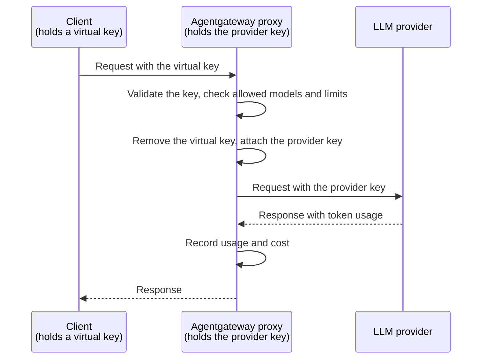

Keep your LLM provider API keys on , and give each coding agent, tool, or user a virtual key that you can revoke.

## About

Coding agents such as OpenCode, Codex, and Claude Code usually authenticate with a provider API key, such as an OpenAI or Anthropic key. That key ends up in a config file or environment variable on every laptop, CI runner, and workspace where the agent runs. When the provider asks you to rotate the key, or a copy leaks, you have to find and replace every copy.

With  in front of your LLM providers, the provider keys stay in a Kubernetes Secret in your cluster. Each client gets a virtual key instead. A virtual key works only against , and you can revoke it without affecting any other client.



When a request arrives, the  proxy does the following:

1. Validates the virtual key. A missing, unknown, or revoked key gets a `401` response.
2. Applies your policies, such as which models clients can use and how many tokens each key can spend.
3. Removes the virtual key from the request and attaches the provider key from the Secret that the  references. The provider never receives the virtual key, and the client never sees the provider key.
4. Records the token usage and cost of the request in metrics and logs, which you can attribute to the user of each key.

Because the provider keys live in one place, routine and emergency changes happen in the cluster only.

| When you need to | Change in the cluster | Change on clients |
| -- | -- | -- |
| Rotate a provider key | Update the Secret that holds the provider key. | None. |
| Revoke a client | Remove its virtual key from the ConfigMap. Its next request gets a `401` response. | None for other clients. |
| Limit the damage from a copied virtual key | Set a token budget for each key. | None. |
| Allow only some models | Add an authorization rule for the requested model. | None. |

### More security considerations

This pattern does not remove the risk of a leaked key. It moves the provider keys into your cluster, where you control access to them. The Secret holds a provider key that every client depends on, so protect it as you would any other production credential.

* **Restrict who can read the Secret.** Limit the Kubernetes RBAC permissions to read Secrets in the namespace of the .
* **Encrypt client traffic.** Virtual keys are bearer credentials. Serve clients over [HTTPS](), or keep the Gateway on a private network.
* **Keep  up to date** with security patches.

## Before you begin



The OpenAI provider guide stores your OpenAI API key in the `openai-secret` Secret, and creates an `openai`  that references the Secret in its `policies.auth.secretRef` field. Clients never need this key. Use the HTTPRoute that matches all paths, so that clients can send requests to the `/v1/chat/completions` path. For other options of providing the API key to , see [Provider API keys]().

## Step 1: Create virtual keys

Store a SHA-256 hash of each virtual key in a ConfigMap. Clients send the raw key, and the proxy hashes it and compares it to the stored hash, so usable keys never have to exist in the cluster.

1. Generate a hash for each virtual key. This example creates keys for Alice and Bob. Do not include a trailing newline.

   ```sh
   printf '%s' 'vk-alice-4f9c2a' | sha256sum | awk '{print "sha256:"$1}'   # alice
   printf '%s' 'vk-bob-8d1e7b' | sha256sum | awk '{print "sha256:"$1}'     # bob
   ```

2. Create a ConfigMap with the hash and metadata of each key. The label lets the authentication policy in the next step select the ConfigMap.

   ```yaml
   kubectl apply -f- <<EOF
   apiVersion: v1
   kind: ConfigMap
   metadata:
     name: llm-api-keys
     namespace: 
     labels:
       agentgateway.dev/apikey: "true"
   data:
     alice: |
       {
         "keyHash": "sha256:84d589f2439e4d9ff4438aa840e63ffcbf231a87e7fef929f975d2bde03dc78c",
         "metadata": {
           "user_id": "alice"
         }
       }
     bob: |
       {
         "keyHash": "sha256:8373319fb10e2e023343d98ade630529f49c53f567cbc6626d09aaf650b2e58c",
         "metadata": {
           "user_id": "bob"
         }
       }
   EOF
   ```

## Step 2: Require virtual keys and allow only some models

Create an  that requires a valid virtual key for every request to the Gateway, and that allows requests for only the models that you list. Put both settings in one policy. If two policies target the same Gateway, one policy silently overwrites the other.

```yaml
kubectl apply -f- <<EOF
apiVersion: 
kind: 
metadata:
  name: api-key-auth
  namespace: 
spec:
  targetRefs:
    - group: gateway.networking.k8s.io
      kind: Gateway
      name: agentgateway-proxy
  traffic:
    apiKeyAuthentication:
      mode: Strict
      configMapSelector:
        matchLabels:
          agentgateway.dev/apikey: "true"
    authorization:
      action: Require
      policy:
        matchExpressions:
          - 'request.method != "POST" || json(request.body).model in ["gpt-4o-mini", "gpt-4o"]'
EOF
```

{}

| Setting | Description |
| -- | -- |
| `apiKeyAuthentication.mode` | Set to `Strict` so that every request needs a valid virtual key. |
| `configMapSelector` | Selects the ConfigMaps that hold the virtual keys. |
| `authorization.action` | Set to `Require` so that a request is denied with a `403` response unless the expression is true. |
| `matchExpressions` | Allows a `POST` request only if the `model` field in the request body is in the list. Requests without a body, such as a `GET` request to list models, are allowed. To allow different models for each user, combine the expression with the user of the key, such as `apiKey.user_id == "bob"`. |

## Step 3: Connect a client with a virtual key

Give each client the Gateway address and its virtual key, instead of a provider key. Most clients accept a custom base URL for an OpenAI-compatible API, such as `http://$INGRESS_GW_ADDRESS/v1`, and an API key. For example, see the guides for [OpenCode](), [Codex](), and [other LLM clients]().

If you use port-forwarding instead of a LoadBalancer address, replace `$INGRESS_GW_ADDRESS` with `localhost:8080` in the following requests.

1. Send a request with Alice's virtual key. The request succeeds.

   ```sh
   curl -s "$INGRESS_GW_ADDRESS/v1/chat/completions" \
     -H "Authorization: Bearer vk-alice-4f9c2a" \
     -H "Content-Type: application/json" \
     -d '{"model": "gpt-4o-mini", "messages": [{"role": "user", "content": "Hello!"}]}' | jq .
   ```

2. Send a request for a model that is not in the list, such as `o3`. The request is rejected with a `403` response, even though the provider key could use that model.

   ```sh
   curl -s -w "\n%{http_code}\n" "$INGRESS_GW_ADDRESS/v1/chat/completions" \
     -H "Authorization: Bearer vk-alice-4f9c2a" \
     -H "Content-Type: application/json" \
     -d '{"model": "o3", "messages": [{"role": "user", "content": "Hello!"}]}'
   ```

   Example output:

   ```
   authorization failed
   403
   ```

3. Send a request with a key that is not in the ConfigMap. The request is rejected with a `401` response.

   ```sh
   curl -s -w "\n%{http_code}\n" "$INGRESS_GW_ADDRESS/v1/chat/completions" \
     -H "Authorization: Bearer vk-unknown" \
     -H "Content-Type: application/json" \
     -d '{"model": "gpt-4o-mini", "messages": [{"role": "user", "content": "Hello!"}]}'
   ```

   Example output:

   ```
   api key authentication failure: invalid credentials
   401
   ```

## Step 4: Rotate and revoke keys

Make the following changes in the cluster. You do not need to restart the proxy or change the configuration of any client.

* **Rotate the provider key**: Update the Secret with the new key. The proxy sends the new key with subsequent requests. After you verify that requests still succeed, revoke the old key in the console of your provider.

  ```sh
  kubectl create secret generic openai-secret -n  \
    --from-literal=Authorization="$NEW_OPENAI_API_KEY" \
    --dry-run=client -o yaml | kubectl apply -f -
  ```

* **Revoke a virtual key**: Remove the key from the ConfigMap. The next request with that key gets a `401` response.

  ```sh
  kubectl patch configmap llm-api-keys -n  \
    --type=json -p='[{"op": "remove", "path": "/data/bob"}]'
  ```

  Then send a request with Bob's key.

  ```sh
  curl -s -o /dev/null -w "%{http_code}\n" "$INGRESS_GW_ADDRESS/v1/chat/completions" \
    -H "Authorization: Bearer vk-bob-8d1e7b" \
    -H "Content-Type: application/json" \
    -d '{"model": "gpt-4o-mini", "messages": [{"role": "user", "content": "Hello!"}]}'
  ```

  Example output:

  ```
  401
  ```

To give each key its own token budget and to track the usage of each key, see [Virtual keys](). To see the cost of each request, see [Model costs]().

## Cleanup



```sh
kubectl delete  api-key-auth -n 
kubectl delete configmap llm-api-keys -n 
```

## Next steps


  
  
  

