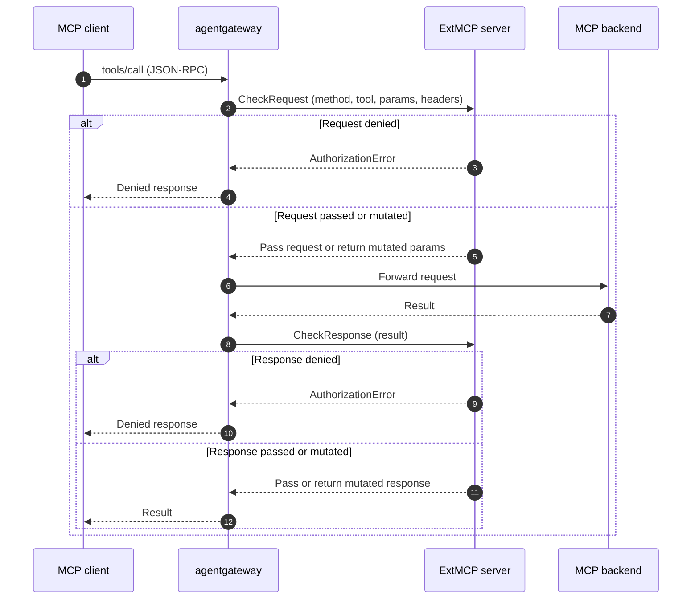

Use guardrail processors (`mcpGuardrails`) to inspect, rewrite, or reject Model Context Protocol (MCP) requests and responses. Write processors as Common Expression Language (CEL) expressions that run inside agentgateway, or use an external gRPC server that implements ExtMCP.

Guardrail processors are one of three ways to filter MCP traffic. To compare them with target conditions and MCP authorization, see [About MCP guardrails]().

## About guardrail processors

 supports [external authorization]()[external authorization]() and [external processing (ExtProc)]()[external processing (ExtProc)]() for HTTP traffic. These integrations require the external server to assemble the HTTP body, parse JSON-RPC, and handle MCP framing.

Guardrail processors receive the MCP method name, target, and request parameters or response result directly. They can evaluate access to tools, prompts, and resources without parsing raw HTTP.

Common use cases include the following:

* Reject `tools/call` requests based on the tool name, its arguments, or the caller's identity.
* Mask sensitive data in tool arguments before they reach the MCP server, or in results before they reach the client.
* Rewrite `tools/list` responses, such as to annotate tool descriptions.
* Centralize MCP policy logic in an external service that you already operate.

## Processor types {#processor-types}

Configure guardrails as an ordered list of processors. Each processor handles selected MCP methods and uses one of these types:

| Processor | Field`kind` | Where it runs | Use it to |
|-----------|------|---------------|-----------|
| CEL expression | `expression` | In the agentgateway proxy | Reject a call when a condition matches, or rewrite the request parameters or response result. No extra service to deploy or operate. |
| Remote (ExtMCP) | `remote` | In an external gRPC server that you deploy | Call other systems, run stateful checks, or write policy logic in your own language. |

You can combine both types in the same guardrails policy. For example, reject disallowed calls with CEL before a remote processor runs more expensive checks.

## How it works

For each configured MCP method, processors run in the request phase, response phase, or both.

Rejections return a JSON-RPC error for methods other than `tools/call`. For `tools/call`, denials return a tool result with `isError: true`, except for internal errors. See [Error codes](#error-codes) for details.

The following diagram shows a remote processor. A CEL expression processor follows the same flow, but agentgateway evaluates the expression in-process instead of calling an external server.



Each processor returns one of three outcomes for each call:

* **Pass**: Allow the request or response unchanged.
* **Mutate**: Replace the JSON-RPC `params` (request phase) or `result` (response phase) before agentgateway forwards it.
* **Deny**: Return an error to the client in either phase.

### Request mutation trust boundary

Treat processors that can change JSON-RPC `params` as trusted components. They can change the request sent upstream, but cannot change the selected backend.

For `tools/call`, `prompts/get`, and `resources/read`, agentgateway selects the backend and resolves the requested name or URI before processors run. MCP authorization checks that original backend and resolved identifier after the processors allow the request. Changing an identifier does not cause agentgateway to resolve it again or update the authorization context.

To authorize the changed identifier or parameters, add a processor that checks them after the last mutating processor. Alternatively, enforce that check in the final mutating processor.

## Configuration

This policy first rejects calls to `delete_records` with CEL. It then sends tool calls and tool listings to a remote ExtMCP server.


```yaml
apiVersion: 
kind: 
metadata:
  name: mcp-guardrails
spec:
  targetRefs:
    - group: 
      kind: 
      name: mcp-backend
  backend:
    mcp:
      guardrails:
        processors:
        - expression:
            condition: mcp.params.name == "delete_records"
            reject: "delete_records is not available through this gateway"
          methods:
            tools/call: Request
        - remote:
            backendRef:
              name: ext-mcp
              port: 4445
            failureMode: FailClosed
          methods:
            tools/call: Request
            tools/list: Response
```


```yaml
mcpGuardrails:
  processors:
  - kind: expression
    condition: mcp.params.name == "delete_records"
    reject: "delete_records is not available through this gateway"
    methods:
      tools/call: request
  - kind: remote
    host: "localhost:9001"
    failureMode: failClosed
    methods:
      tools/call: request
      tools/list: response
```


Each processor uses a `methods` map to select MCP methods and phases. Other settings depend on its type.

### CEL expression processors {#expression}

A CEL expression processor evaluates an optional condition and then takes exactly one action.

| Setting | Description |
|---------|-------------|
| `condition` | Optional boolean CEL expression. If `false`, pass the message unchanged. If omitted, apply the action to every matched method. |
| `reject` | Rejection message. Returned as tool error text for `tools/call`, or as the JSON-RPC error message for other methods. |
| `transform` | CEL expression that returns a replacement body: `mcp.params` in the request phase, or `mcp.result` in the response phase. Use `merge` to preserve other fields. Return `null` to leave the body unchanged. |

Expression processors can read the usual MCP policy variables, such as `request`, `jwt`, `mcp.methodName`, and `mcp.tool`. They also expose these payload variables:

| Variable | Phase | Description |
|----------|-------|-------------|
| `mcp.params` | Request | The current MCP request's `params` object. For `tools/call`, `mcp.params.name` is the resolved tool name that agentgateway sends to the target, without a target-name prefix. |
| `mcp.result` | Response | The current MCP response's `result` object. |

Processors run in order, and each processor sees the changes from earlier processors. To make a rejection rule see the original request, list it before any processor that masks the same fields.

Use `regexReplace` to replace the first regular expression match, or `regexReplaceAll` to replace every non-overlapping match. Both support capture groups in replacements, such as `$1`. For the full list of functions, see the [CEL reference]().

Expression processors fail closed. If an expression fails to evaluate, or if a transform returns a body that is not a valid MCP message, agentgateway rejects the call with an internal error.

### Remote processors {#remote}

A remote processor calls an external gRPC server that implements the [ExtMCP protocol](https://github.com/agentgateway/agentgateway/blob/main/crates/protos/proto/ext_mcp.proto). ExtMCP follows the model of Envoy's `ext_authz` filter. The server receives the MCP method name, target, request parameters or response result, and selected request headers.

* **The ExtMCP server**: The `remote.backendRef``remote` reference, such as `host` points to the gRPC server that enforces the processor.
* **The failure mode**: The `failureMode` setting controls what happens when the server is unreachable or returns an error. See [Failure modes](#failure-modes).

### Methods

The `methods` map keys are the JSON-RPC method names from the [MCP specification](https://modelcontextprotocol.io/specification), such as `tools/call`, `tools/list`, `prompts/get`, and `resources/read`. Each key maps to the phase in which agentgateway runs the processor for that method.

Method keys can be exact (`tools/call`), a prefix wildcard (`tools/*`), a suffix wildcard (`*/list`), or `*` for all methods. The most specific match wins. Methods that match no key, including unknown methods, bypass the processor.

### Phases

Set a phase for each method to control when its processor runs.

| Phase | Kubernetes value | Standalone value | When the processor runs |
|-------|------------------|------------------|---------------------------|
| Off | `Off` | `off` | Never. The method bypasses this processor. |
| Request | `Request` | `request` | Before the request reaches the MCP backend. Use to gate or mutate the incoming call. |
| Response | `Response` | `response` | After the MCP backend returns a result. Use to filter or rewrite the response. |
| Full | `Full` | `full` | Both the request and response phases. |

### Failure modes

The `failureMode` setting of a remote processor controls what happens when the server is unreachable or returns an error.

| Behavior | Kubernetes value | Standalone value | Description |
|----------|------------------|------------------|-------------|
| Fail closed (default) | `FailClosed` | `failClosed` | Deny the request. Use when the policy server must approve every call. |
| Fail open | `FailOpen` | `failOpen` | Allow the request. Use when availability matters more than strict enforcement. |

### Ordering and multiplexing

Keep the following behaviors in mind when you design a policy:

* MCP authentication runs before request-phase processors. Agentgateway does not repeat authentication after request mutation.
* Processors run in the order listed. The first processor to deny a request short-circuits the chain.
* Request-phase processors run before MCP authorization. If a processor rejects a call, MCP authorization does not run for that call.
* Request-phase processors receive tool and prompt names without the target-name prefix. Agentgateway passes the target name separately.
* For fanout methods such as `tools/list`, the request phase runs once before agentgateway contacts any target. The response phase runs once on the merged result, after MCP authorization removes denied items. Multiplexed names include the target-name prefix, such as `everything_echo`.

### Error codes

When a processor denies a call, agentgateway returns a JSON-RPC error to the client. A CEL expression processor that rejects a call uses the `PERMISSION_DENIED` code. For a remote processor, the server's authorization code maps to a JSON-RPC error code:

| ExtMCP code | JSON-RPC code |
|-------------|---------------|
| `PERMISSION_DENIED` | `-32001` |
| `RESOURCE_EXHAUSTED` | `-32003` |
| `INVALID` | Invalid request |
| `UNKNOWN` | Internal error |

The error `message` comes from the CEL processor's `reject` setting or the remote server's `reason` field.

A remote server can also set `mcp_error` to a JSON value for the error's `data` field. This payload does not change the code or message. Agentgateway ignores invalid JSON.

For `tools/call`, the table applies only to `UNKNOWN` and internal failures. Examples include a CEL evaluation error or an unreachable remote server configured to fail closed.

Other `tools/call` denials return HTTP 200 with a tool result containing `isError: true` and the rejection message. This result does not include `mcp_error`. For all other MCP methods, the table applies to every code.
