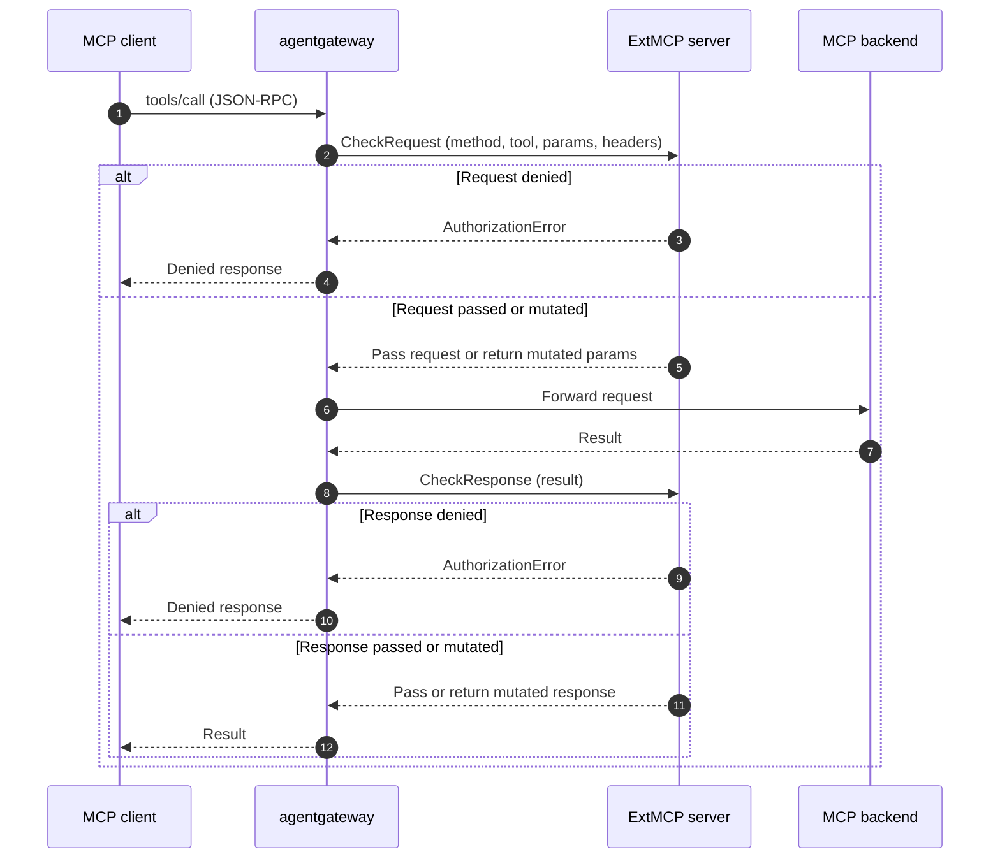

Use MCP guardrails to inspect, mutate, or reject individual Model Context Protocol (MCP) requests and responses, such as `tools/call` and `tools/list`. Guardrails act on the MCP request context instead of generic HTTP metadata. You can write a guardrail as an in-process Common Expression Language (CEL) expression, or call out to an external gRPC policy server that implements the ExtMCP protocol.

## About MCP guardrails

 already supports [external authorization]()[external authorization]() and [external processing (ExtProc)]()[external processing (ExtProc)]() for HTTP traffic. However, these integrations operate on raw HTTP. To make a decision about an MCP tool call, the external server must reassemble the HTTP body, parse the JSON-RPC envelope, and handle MCP framing itself.

MCP guardrails solve this challenge by running at the MCP method layer instead of the HTTP layer. Each guardrail receives a structured, MCP-native view of the call, including the JSON-RPC method name, the target, and the request parameters or response result. The guardrail can then make a decision based on the actual tool, prompt, or resource that is being accessed, without re-implementing MCP semantics.

Common use cases include the following:

* Reject `tools/call` requests based on the tool name, its arguments, or the caller's identity.
* Mask sensitive data, such as email addresses or secrets, in tool arguments before they reach the MCP server, or in tool results before they reach the client.
* Filter `tools/list` responses so that clients see only the tools that they are allowed to use.
* Centralize MCP policy logic in an external service that you already operate.

## Processor types {#processor-types}

You configure MCP guardrails as an ordered list of *processors*. Each processor handles a set of MCP methods and is one of the following types.

| Processor | Field`kind` | Where it runs | Use it to |
|-----------|------|---------------|-----------|
| CEL expression | `expression` | In the agentgateway proxy | Reject a call when a condition matches, or rewrite the request parameters or response result. No extra service to deploy or operate. |
| Remote (ExtMCP) | `remote` | In an external gRPC server that you deploy | Run logic that CEL cannot express, such as calls to other systems, stateful checks, or policy code in your own language. |

You can combine both types in the same guardrails policy. For example, a CEL processor can reject obviously disallowed calls in-process before a remote processor runs more expensive checks.

## How it works

When a client calls an MCP method that you opt in, agentgateway runs the processor before it forwards the request, after it receives the response, or both. At each step, the processor can pass the message through unchanged, return a mutated message, or reject the call. Agentgateway returns a rejection to the client as a JSON-RPC error. The exception is a rejected `tools/call` request, which returns a tool result with `isError: true` instead, so that MCP clients can show the rejection as a tool-execution error. For details, see [Error codes](#error-codes).

The following diagram shows a remote processor. A CEL expression processor follows the same flow, but agentgateway evaluates the expression in-process instead of calling an external server.



Each processor returns one of three outcomes for each call:

* **Pass**: Allow the request or response unchanged.
* **Mutate**: Replace the JSON-RPC `params` (request phase) or `result` (response phase) before agentgateway forwards it.
* **Deny**: Reject the call with an error that is returned to the client. A processor can deny a call in either the request phase or the response phase.

### Request mutation trust boundary

A request-phase processor can replace the JSON-RPC `params` before agentgateway sends the request to the selected backend. Treat every processor that can mutate `params` as a trusted component. A mutation can determine the effective request, but it does not change the selected backend.

For `tools/call`, `prompts/get`, and `resources/read`, agentgateway selects the backend and resolves the original tool name, prompt name, or resource URI before request-phase processors run. If the processor chain allows the request, CEL-based MCP authorization then evaluates the original backend and resolved identifier. Agentgateway does not automatically re-resolve a changed identifier or replace the values used for that authorization check.

If authorization must cover the post-mutation identifier or parameters, place the authorization processor after the last processor that can change them. Alternatively, the final mutating processor can enforce that authorization itself.

## Configuration

The following example shows a guardrails policy with two processors. The first processor is a CEL expression that rejects calls to a `delete_records` tool. The second processor sends every tool call and tool listing to a remote ExtMCP server.


```yaml
apiVersion: 
kind: 
metadata:
  name: mcp-guardrails
spec:
  targetRefs:
    - group: 
      kind: 
      name: mcp-backend
  backend:
    mcp:
      guardrails:
        processors:
        - expression:
            condition: mcp.params.name == "delete_records"
            reject: "delete_records is not available through this gateway"
          methods:
            tools/call: Request
        - remote:
            backendRef:
              name: ext-mcp
              port: 4445
            failureMode: FailClosed
          methods:
            tools/call: Request
            tools/list: Response
```


```yaml
mcpGuardrails:
  processors:
  - kind: expression
    condition: mcp.params.name == "delete_records"
    reject: "delete_records is not available through this gateway"
    methods:
      tools/call: request
  - kind: remote
    host: "localhost:9001"
    failureMode: failClosed
    methods:
      tools/call: request
      tools/list: response
```


Every processor sets a `methods` map that selects which MCP methods run through the processor and in which phase. The remaining settings depend on the processor type.

### CEL expression processors {#expression}

A CEL expression processor evaluates an optional condition and then takes exactly one action.

| Setting | Description |
|---------|-------------|
| `condition` | Optional CEL expression that must return a boolean. When the expression returns `false`, the processor passes the message through unchanged. When you omit the condition, the action applies to every matched method. |
| `reject` | Message to return to the client when the processor rejects the call. The client receives this message as the tool error text for `tools/call`, or as the JSON-RPC error message for other methods. |
| `transform` | CEL expression that returns a replacement body: `mcp.params` in the request phase, or `mcp.result` in the response phase. Use `merge` to preserve the fields that you do not want to change. Return `null` to leave the body unchanged. |

In addition to the variables that are available to other MCP policies, such as `request`, `jwt`, `mcp.methodName`, and `mcp.tool`, an expression processor can read the following variables.

| Variable | Phase | Description |
|----------|-------|-------------|
| `mcp.params` | Request | The current request parameters, with the same structure as the `params` object of the MCP request. For `tools/call`, `mcp.params.name` is the resolved tool name that agentgateway sends to the target, without a target-name prefix. |
| `mcp.result` | Response | The current response result, with the same structure as the `result` object of the MCP response. |

Processors run in order, and each processor sees the changes from earlier processors. To make a rejection rule see the original request, list it before any processor that masks the same fields.

To rewrite text, use the `regexReplace` function to replace the first match of a regular expression, or `regexReplaceAll` to replace every non-overlapping match. Both functions support capture groups in the replacement, such as `$1`. For the full list of functions, see the [CEL reference]().

Expression processors fail closed. If an expression fails to evaluate, or if a transform returns a body that is not a valid MCP message, agentgateway rejects the call with an internal error.

### Remote processors {#remote}

A remote processor calls an external gRPC server that implements the [ExtMCP protocol](https://github.com/agentgateway/agentgateway/blob/main/crates/protos/proto/ext_mcp.proto). The ExtMCP protocol is modeled on Envoy's `ext_authz` filter, but the server receives an MCP-native payload, including the JSON-RPC method name, the target, the request or response parameters, and selected request headers.

* **The ExtMCP server**: The `remote.backendRef``remote` reference, such as `host` points to the gRPC server that enforces the processor.
* **The failure mode**: The `failureMode` setting controls what happens when the server is unreachable or returns an error. See [Failure modes](#failure-modes).

### Methods

The `methods` map keys are the JSON-RPC method names from the [MCP specification](https://modelcontextprotocol.io/specification), such as `tools/call`, `tools/list`, `prompts/get`, and `resources/read`. Each key maps to the phase in which agentgateway runs the processor for that method.

Method keys can be exact (`tools/call`), a prefix wildcard (`tools/*`), a suffix wildcard (`*/list`), or `*` for all methods. The most specific match wins. Methods that match no key, including unknown methods, bypass the processor.

### Phases

The phase controls when agentgateway runs the processor for a method. Set a phase for each method that you want to send to the processor.

| Phase | Kubernetes value | Standalone value | When the processor runs |
|-------|------------------|------------------|---------------------------|
| Off | `Off` | `off` | Never. The method bypasses this processor. |
| Request | `Request` | `request` | Before the request reaches the MCP backend. Use to gate or mutate the incoming call. |
| Response | `Response` | `response` | After the MCP backend returns a result. Use to filter or rewrite the response. |
| Full | `Full` | `full` | Both the request and response phases. |

### Failure modes

The `failureMode` setting of a remote processor controls what happens when the server is unreachable or returns an error.

| Behavior | Kubernetes value | Standalone value | Description |
|----------|------------------|------------------|-------------|
| Fail closed (default) | `FailClosed` | `failClosed` | Deny the request. Use when the policy server must approve every call. |
| Fail open | `FailOpen` | `failOpen` | Allow the request. Use when availability matters more than strict enforcement. |

### Ordering and multiplexing

Keep the following behaviors in mind when you design a policy:

* MCP authentication runs before request-phase processors. Agentgateway does not repeat authentication after request mutation.
* Processors run in the order listed. The first processor to deny a request short-circuits the chain.
* Request-phase processors run before MCP authorization. If a processor rejects a call, MCP authorization does not run for that call.
* For calls to a single tool, prompt, or resource, such as `tools/call`, agentgateway passes the name to request-phase processors in its original, un-prefixed form. When agentgateway multiplexes several targets, it passes the target name separately rather than in the tool name.
* For fanout methods such as `tools/list`, agentgateway runs the request phase once, before it contacts any target. It runs the response phase once, on the merged result from all targets. By then, MCP authorization has already removed the items that the client is not allowed to see, and multiplexed names carry the target-name prefix, such as `everything_echo`.

### Error codes

When a processor denies a call, agentgateway returns a JSON-RPC error to the client. A CEL expression processor that rejects a call uses the `PERMISSION_DENIED` code. For a remote processor, the server's authorization code maps to a JSON-RPC error code:

| ExtMCP code | JSON-RPC code |
|-------------|---------------|
| `PERMISSION_DENIED` | `-32001` |
| `RESOURCE_EXHAUSTED` | `-32003` |
| `INVALID` | Invalid request |
| `UNKNOWN` | Internal error |

The error `message` is the `reject` message of a CEL expression processor, or the `reason` of a remote server. A remote server can also set the optional `mcp_error` field to a JSON value, which the client receives in the error's `data` field. The `mcp_error` payload does not change the error code or message. If the payload is not valid JSON, it is ignored.

For `tools/call`, the table applies only to the `UNKNOWN` code and to internal failures, such as an unreachable server when the failure mode denies the request, or a CEL expression that fails to evaluate. Every other `tools/call` denial returns an HTTP 200 response with a tool result where `isError: true` and the text content is the rejection message. The `mcp_error` payload is not included in that tool result. For all other MCP methods, the table applies to every code.
