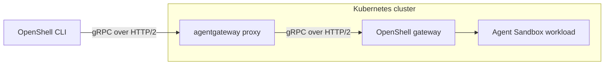

[OpenShell](https://github.com/NVIDIA/OpenShell) runs AI agents in sandboxes. Use agentgateway as its Kubernetes Gateway API implementation to route OpenShell CLI requests to the OpenShell gateway.

The OpenShell Helm chart creates a dedicated `Gateway` and `GRPCRoute`. Setting `grpcRoute.gateway.className` to `agentgateway` selects agentgateway to provision the proxy.

## Architecture



This guide routes OpenShell's gRPC control traffic through agentgateway. It does not configure agent LLM or MCP traffic. The explicit Gateway name, `openshell-ingress`, prevents the proxy Service created by agentgateway from colliding with the OpenShell Service named `openshell`.

> [!WARNING]
> This example disables TLS and authentication for local development and uses a loopback port-forward for CLI access. Before exposing the gateway, configure TLS and authentication as described in [Secure external access](#secure-external-access).

## Before you begin

- A Kubernetes cluster whose CNI enforces ingress and egress `NetworkPolicy`. Kind's default CNI does not enforce NetworkPolicy; use a CNI that does.
- [agentgateway installed](), with the `agentgateway` GatewayClass and Gateway API CRDs, including `GRPCRoute`. The [upstream example](https://github.com/agentgateway/agentgateway/tree/main/examples/openshell) was tested with agentgateway v1.6.0.
- [Agent Sandbox installed](https://github.com/kubernetes-sigs/agent-sandbox#installation), including its CRDs and controller. The upstream example was tested with Agent Sandbox v1.0.6.
- Helm, `kubectl`, and the [OpenShell CLI](https://github.com/NVIDIA/OpenShell/blob/v0.1.3/docs/about/installation.mdx). Use OpenShell v0.1.3 to match the chart in this guide.
- Network access to pull images, manifests, and Helm charts, and available loopback port `18080`.

The stable OpenShell 0.1.3 chart includes the GatewayClass support from [OpenShell PR #4345](https://github.com/NVIDIA/OpenShell/pull/4345). The upstream agentgateway example pins an earlier development build; this guide uses the stable chart and its matching default image tags.

## Configure OpenShell

1. Save the following configuration as `openshell-values.yaml`.

   ```yaml
   server:
     disableTls: true
     auth:
       allowUnauthenticatedUsers: true

   grpcRoute:
     enabled: true
     gateway:
       create: true
       className: agentgateway
       name: openshell-ingress
   ```

2. Install OpenShell with the example values.

   ```bash
   helm upgrade --install openshell \
     oci://ghcr.io/nvidia/openshell/helm-chart \
     --version 0.1.3 \
     --create-namespace \
     --namespace openshell \
     --values openshell-values.yaml \
     --wait \
     --timeout 10m
   ```

   The chart creates an HTTP listener on port `80` and routes gRPC requests to the OpenShell Service on port `8080`. OpenShell manages the sandbox workloads; agentgateway manages the ingress proxy.

## Verify the integration

1. Wait for the Gateway, route, and workloads to become ready.

   ```bash
   kubectl wait --for=condition=Programmed gateway/openshell-ingress \
     -n openshell --timeout=5m
   kubectl wait \
     --for=jsonpath='{.status.parents[0].conditions[?(@.type=="Accepted")].status}'=True \
     grpcroute/openshell -n openshell --timeout=5m
   kubectl wait \
     --for=jsonpath='{.status.parents[0].conditions[?(@.type=="ResolvedRefs")].status}'=True \
     grpcroute/openshell -n openshell --timeout=5m
   kubectl rollout status deployment/openshell-ingress \
     -n openshell --timeout=5m
   kubectl rollout status statefulset/openshell \
     -n openshell --timeout=5m
   ```

2. In one terminal, forward the agentgateway proxy Service.

   ```bash
   kubectl port-forward -n openshell service/openshell-ingress 18080:80
   ```

3. In a second terminal, register the gateway and run a sandbox smoke test. Run these commands in a subshell with a temporary configuration directory to preserve your existing OpenShell gateway registrations and shell environment.

   ```bash
   (
     export XDG_CONFIG_HOME="$(mktemp -d)"
     openshell gateway add http://127.0.0.1:18080 \
       --local --name agentgateway-example
     openshell status

     openshell sandbox create \
       --name agw-example --detach -- sleep 3600
     openshell sandbox exec agw-example \
       --no-login-shell -- sh -c 'printf agentgateway-openshell'
     openshell sandbox delete agw-example
     rm -rf "$XDG_CONFIG_HOME"
   )
   ```

   The exec command prints `agentgateway-openshell`. Stop the port-forward with Control-C when testing is complete.

## Secure external access

For external access, terminate client TLS at agentgateway, encrypt the connection from agentgateway to OpenShell, and let OpenShell validate OIDC bearer tokens and authorize CLI operations.

```text
OpenShell CLI → HTTPS → agentgateway → TLS → OpenShell gateway
```

You need a DNS hostname for the agentgateway proxy Service, a certificate trusted by your CLI clients, and an OIDC provider configured to issue access tokens for OpenShell. The example uses `gateway.example.com`, audience and client ID `openshell-cli`, and roles in the `realm_access.roles` claim. Replace these values with your hostname and identity provider settings. Configure both `openshell-admin` and `openshell-user` roles and assign the appropriate role to each caller. See the [OpenShell OIDC authentication reference](https://github.com/NVIDIA/OpenShell/blob/v0.1.3/docs/how-it-works/gateways/authentication.mdx#oidc) for login flows and the [OpenShell access control reference](https://github.com/NVIDIA/OpenShell/blob/v0.1.3/docs/kubernetes/access-control.mdx#oidc-user-authentication) for role configuration.

1. Create a TLS Secret in the `openshell` namespace with the certificate and key for your external hostname. For certificate requirements and listener configuration, see [agentgateway HTTPS listeners]().

   ```bash
   kubectl -n openshell create secret tls openshell-ingress-tls \
     --cert=tls.crt --key=tls.key
   ```

2. Save the following complete configuration as `openshell-secure-values.yaml`. Use this file instead of the development values above.

   ```yaml
   server:
     disableTls: false
     auth:
       allowUnauthenticatedUsers: false
     tls:
       enableMtls: false

   gatewayConfig:
     openshell.gateway.oidc:
       issuer: https://idp.example.com/realms/openshell
       audience: openshell-cli
       roles_claim: realm_access.roles
       admin_role: openshell-admin
       user_role: openshell-user

   grpcRoute:
     enabled: true
     hostnames:
       - gateway.example.com
     gateway:
       create: true
       className: agentgateway
       name: openshell-ingress
       listener:
         protocol: HTTPS
         port: 443
         tls:
           certificateRefs:
             - name: openshell-ingress-tls
     backendTLSPolicy:
       enabled: true
   ```

   The chart creates a `BackendTLSPolicy` for Service `openshell`. By default, its PKI hook creates the backend CA ConfigMap `openshell-backend-ca`, and agentgateway validates the backend certificate against that CA and hostname `openshell.openshell.svc.cluster.local`. See [agentgateway backend TLS]() for how this policy secures the backend connection. The frontend certificate Secret and backend CA ConfigMap serve different TLS connections.

   Client TLS terminates at agentgateway, so OpenShell cannot use the original CLI client certificate for identity. `server.tls.enableMtls=false` allows the backend TLS connection without requiring a client certificate from the proxy. OpenShell instead validates the bearer token forwarded in the gRPC `authorization` metadata and applies its configured roles. Keep anonymous access disabled; this path uses OpenShell's OIDC login flow.

3. Upgrade the example release with the secure configuration. `--reset-values` replaces the development overrides with chart defaults and this values file. If you are adapting an existing deployment, include its other required settings in the file before upgrading.

   ```bash
   helm upgrade --install openshell \
     oci://ghcr.io/nvidia/openshell/helm-chart \
     --version 0.1.3 \
     --namespace openshell \
     --reset-values \
     --values openshell-secure-values.yaml \
     --wait \
     --timeout 10m
   ```

4. Repeat the Gateway, route, and workload readiness checks above, and inspect the backend TLS policy. Confirm that its status reports `Accepted=True` and `ResolvedRefs=True`.

   ```bash
   kubectl describe backendtlspolicy openshell -n openshell
   kubectl get configmap openshell-backend-ca -n openshell
   kubectl get service openshell-ingress -n openshell
   ```

   Configure DNS and network access so that your hostname reaches the agentgateway proxy Service on HTTPS port `443`.

5. Register the HTTPS endpoint with the CLI and authenticate with your identity provider.

   ```bash
   openshell gateway add https://gateway.example.com \
     --name production \
     --oidc-issuer https://idp.example.com/realms/openshell \
     --oidc-client-id openshell-cli \
     --oidc-audience openshell-cli
   openshell status -g production
   ```

   Check the authentication result as well as gateway reachability. A successful public health check alone does not demonstrate authenticated access. Run the sandbox smoke test above using `-g production` on each sandbox command to verify authorized operations through the secure endpoint.

## Troubleshooting

- **Gateway is not programmed:** Confirm that the `agentgateway` GatewayClass exists and its controller is running. Inspect `kubectl describe gateway openshell-ingress -n openshell` for listener and provisioning errors.
- **Route is not accepted or references are unresolved:** Inspect `kubectl describe grpcroute openshell -n openshell`. Its parent must be `openshell-ingress` in the `openshell` namespace, and its backend must be Service `openshell` on port `8080`.
- **Proxy Service name conflicts:** Keep `grpcRoute.gateway.name=openshell-ingress`. The chart's default Gateway name would match the OpenShell backend Service name.
- **CLI cannot connect:** Keep the port-forward running and register `http://127.0.0.1:18080`. This local example uses plaintext HTTP/2; HTTPS requires a different listener and authentication configuration.
- **Sandbox creation or exec fails:** Confirm that Agent Sandbox is installed, inspect OpenShell and sandbox workload events, and verify that the CNI enforces the required NetworkPolicies.

## Clean up

Remove the release and namespace only if you created them for this example. For an existing OpenShell deployment, restore its previous Helm values instead.

```bash
helm uninstall openshell --namespace openshell --ignore-not-found
kubectl delete namespace openshell --ignore-not-found
```

## References

- [agentgateway OpenShell example](https://github.com/agentgateway/agentgateway/tree/main/examples/openshell)
- [agentgateway integration PR #3908](https://github.com/agentgateway/agentgateway/pull/3908)
- [OpenShell GatewayClass support PR #4345](https://github.com/NVIDIA/OpenShell/pull/4345)
- [OpenShell Helm chart configuration](https://github.com/NVIDIA/OpenShell/blob/v0.1.3/deploy/helm/openshell/README.md)
