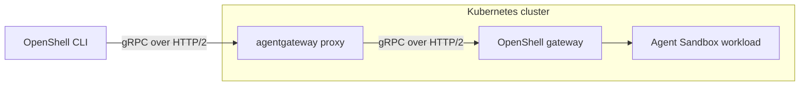

[OpenShell](https://github.com/NVIDIA/OpenShell) runs AI agents in sandboxes. Use agentgateway as its Kubernetes Gateway API implementation to route OpenShell CLI requests to the OpenShell gateway.

The OpenShell Helm chart creates a dedicated Gateway and GRPCRoute. Setting `grpcRoute.gateway.className` to `agentgateway` selects agentgateway to provision the proxy.

## Architecture

The following diagram shows how an OpenShell CLI request reaches a sandbox through agentgateway.



1. The OpenShell CLI sends gRPC requests over HTTP/2 to the agentgateway proxy.
2. The agentgateway proxy forwards the requests over HTTP/2 to the OpenShell gateway inside the Kubernetes cluster.
3. The OpenShell gateway creates and manages the Agent Sandbox workloads.

This guide routes OpenShell's gRPC control traffic through agentgateway. It does not configure agent LLM or MCP traffic.

> [!WARNING]
> This example disables TLS and authentication for local development and uses a loopback port-forward for CLI access. Before exposing the gateway, configure TLS and authentication as described in [Secure external access](#secure-external-access).

## Before you begin

- A Kubernetes cluster whose CNI enforces ingress and egress NetworkPolicy. Kind's default CNI does not enforce NetworkPolicy; use a CNI that does.
- Cluster nodes with a Linux kernel that meets the OpenShell sandbox requirements. For details, see the [OpenShell support matrix](https://github.com/NVIDIA/OpenShell/blob/v/docs/about/support-matrix.mdx).
- [agentgateway installed](), with the `agentgateway` GatewayClass and Gateway API CRDs, including GRPCRoute. The [example in the agentgateway repository](https://github.com/agentgateway/agentgateway/tree/main/examples/openshell) was tested with agentgateway v1.6.0.
- [Agent Sandbox installed](https://github.com/kubernetes-sigs/agent-sandbox#installation), including its CRDs and controller. The example was tested with Agent Sandbox v.
- Helm, `kubectl`, and the [OpenShell CLI](https://github.com/NVIDIA/OpenShell/blob/v/docs/about/installation.mdx). Use OpenShell v to match the chart in this guide.
- Network access to pull images, manifests, and Helm charts, and available loopback port `18080`.

## Configure OpenShell

1. Save the following configuration as `openshell-values.yaml`.

   ```yaml
   server:
     disableTls: true
     auth:
       allowUnauthenticatedUsers: true

   grpcRoute:
     enabled: true
     gateway:
       create: true
       className: 
       name: openshell-ingress
   ```

   {}

   | Field | Description |
   |-------|-------------|
   | `server.disableTls` | Turns off TLS on the OpenShell gateway so that the proxy can forward plaintext HTTP/2. Use for local development only. |
   | `server.auth.allowUnauthenticatedUsers` | Accepts CLI requests without credentials and treats them as a local developer. Use for local development only. |
   | `grpcRoute.enabled` | Creates the GRPCRoute that sends gRPC requests to the OpenShell Service. |
   | `grpcRoute.gateway.create` | Creates a Gateway in the release namespace. |
   | `grpcRoute.gateway.className` | Selects the `` GatewayClass, so that agentgateway provisions the proxy. |
   | `grpcRoute.gateway.name` | Names the Gateway `openshell-ingress`. The proxy Service takes the name of the Gateway, so the name must differ from the OpenShell Service named `openshell`. |

2. Install OpenShell with the example values.

   ```bash
   helm upgrade --install openshell \
     oci://ghcr.io/nvidia/openshell/helm-chart \
     --version  \
     --create-namespace \
     --namespace openshell \
     --values openshell-values.yaml \
     --wait \
     --timeout 10m
   ```

   The chart creates an HTTP listener on port `80` and routes gRPC requests to the OpenShell Service on port `8080`. OpenShell manages the sandbox workloads; agentgateway manages the ingress proxy.

   Example output, truncated:

   ```text
   NAME: openshell
   NAMESPACE: openshell
   STATUS: deployed
   REVISION: 1
   ```

## Verify the integration

1. Wait for the Gateway, route, and workloads to become ready.

   ```bash
   kubectl wait --for=condition=Programmed gateway/openshell-ingress \
     -n openshell --timeout=5m
   kubectl wait \
     --for=jsonpath='{.status.parents[0].conditions[?(@.type=="Accepted")].status}'=True \
     grpcroute/openshell -n openshell --timeout=5m
   kubectl wait \
     --for=jsonpath='{.status.parents[0].conditions[?(@.type=="ResolvedRefs")].status}'=True \
     grpcroute/openshell -n openshell --timeout=5m
   kubectl rollout status deployment/openshell-ingress \
     -n openshell --timeout=5m
   kubectl rollout status statefulset/openshell \
     -n openshell --timeout=5m
   ```

   Example output:

   ```text
   gateway.gateway.networking.k8s.io/openshell-ingress condition met
   grpcroute.gateway.networking.k8s.io/openshell condition met
   grpcroute.gateway.networking.k8s.io/openshell condition met
   deployment "openshell-ingress" successfully rolled out
   partitioned roll out complete: 1 new pods have been updated...
   ```

2. In one terminal, forward the agentgateway proxy Service.

   ```bash
   kubectl port-forward -n openshell service/openshell-ingress 18080:80
   ```

   Example output:

   ```text
   Forwarding from 127.0.0.1:18080 -> 80
   Forwarding from [::1]:18080 -> 80
   ```

3. In a second terminal, register the gateway and run a sandbox smoke test. Run these commands in a subshell with a temporary configuration directory to preserve your existing OpenShell gateway registrations and shell environment.

   ```bash
   (
     export XDG_CONFIG_HOME="$(mktemp -d)"
     openshell gateway add http://127.0.0.1:18080 \
       --local --name agentgateway-example
     openshell status

     openshell sandbox create \
       --name agw-example --detach -- sleep 3600
     openshell sandbox exec agw-example \
       --no-login-shell -- sh -c 'printf agentgateway-openshell'
     openshell sandbox delete agw-example
     rm -rf "$XDG_CONFIG_HOME"
   )
   ```

   The first two commands print the registration and the gateway status.

   ```text
   ✓ Gateway 'agentgateway-example' added and set as active
     Endpoint: http://127.0.0.1:18080
     Type: local
     Auth: plaintext
   Server Status

     Gateway: agentgateway-example
     Server: http://127.0.0.1:18080
     Status: Connected
     Authentication: Not required (gateway)
     Version: 0.1.3
   ```

   The exec command prints `agentgateway-openshell`. Stop the port-forward with Control-C when testing is complete.

## Secure external access

For external access, terminate client TLS at agentgateway, encrypt the connection from agentgateway to OpenShell, and let OpenShell validate OpenID Connect (OIDC) bearer tokens and authorize CLI operations.

```text
OpenShell CLI → HTTPS → agentgateway → TLS → OpenShell gateway
```

This section upgrades the release that you installed in [Configure OpenShell](#configure-openshell). You need the following:

- A DNS hostname for the agentgateway proxy Service. The example uses `gateway.example.com`.
- A certificate and key for that hostname, issued by a certificate authority (CA) that your CLI clients trust.
- An OIDC provider that issues access tokens for OpenShell. The example uses the audience and client ID `openshell-cli`, and roles in the `realm_access.roles` claim. Configure both the `openshell-admin` and `openshell-user` roles, and assign the appropriate role to each caller. For login flows and role configuration, see the [OpenShell OIDC authentication reference](https://github.com/NVIDIA/OpenShell/blob/v/docs/how-it-works/gateways/authentication.mdx#oidc) and the [OpenShell access control reference](https://github.com/NVIDIA/OpenShell/blob/v/docs/kubernetes/access-control.mdx#oidc-user-authentication).
- An OIDC issuer URL that the OpenShell pod can reach over HTTPS. OpenShell contacts the issuer when it starts, so the pod crash-loops if the issuer is unreachable. If the issuer uses a private CA, set `server.oidc.caConfigMapName` to a ConfigMap that holds the CA bundle in the `ca.crt` key.
- Gateway API CRDs v1.4 or later, which serve BackendTLSPolicy at `v1` in the standard channel.

Replace the example hostname and identity provider settings with your own values.

1. Create a TLS Secret in the `openshell` namespace with the certificate and key for your external hostname. For certificate requirements and listener configuration, see [agentgateway HTTPS listeners]().

   ```bash
   kubectl -n openshell create secret tls openshell-ingress-tls \
     --cert=tls.crt --key=tls.key
   ```

2. Save the following complete configuration as `openshell-secure-values.yaml`. Use this file instead of `openshell-values.yaml`.

   ```yaml
   server:
     disableTls: false
     auth:
       allowUnauthenticatedUsers: false
     tls:
       enableMtls: false

   gatewayConfig:
     openshell.gateway.oidc:
       issuer: https://idp.example.com/realms/openshell
       audience: openshell-cli
       roles_claim: realm_access.roles
       admin_role: openshell-admin
       user_role: openshell-user

   grpcRoute:
     enabled: true
     hostnames:
       - gateway.example.com
     gateway:
       create: true
       className: 
       name: openshell-ingress
       listener:
         protocol: HTTPS
         port: 443
         tls:
           certificateRefs:
             - name: openshell-ingress-tls
     backendTLSPolicy:
       enabled: true
   ```

   {}

   | Field | Description |
   |-------|-------------|
   | `server.disableTls` | Set to `false` so that the OpenShell gateway serves TLS. agentgateway re-encrypts the connection to this endpoint. |
   | `server.auth.allowUnauthenticatedUsers` | Set to `false` to reject requests without valid credentials. Keep anonymous access disabled; this configuration uses the OpenShell OIDC login flow. |
   | `server.tls.enableMtls` | Set to `false`. Client TLS terminates at agentgateway, so OpenShell cannot use the original CLI client certificate for identity, and the proxy cannot present a client certificate to OpenShell. OpenShell instead validates the bearer token that the CLI sends in the gRPC `authorization` metadata, and applies the configured roles. |
   | `gatewayConfig.openshell.gateway.oidc` | The OIDC settings of the OpenShell gateway. The dotted name `openshell.gateway.oidc` is one key, the name of a TOML table, not nested fields. |
   | `issuer` | The OIDC issuer URL. The OpenShell pod must reach this URL over HTTPS when it starts. |
   | `audience` | The audience claim that access tokens must carry. |
   | `roles_claim` | The dot-separated path to the roles array in the token. Keycloak uses `realm_access.roles`, Entra ID uses `roles`, and Okta uses `groups`. |
   | `admin_role` | The role that is required for admin operations. Set `admin_role` and `user_role` together. |
   | `user_role` | The role that is required for standard user operations. |
   | `grpcRoute.hostnames` | The hostnames that the GRPCRoute matches. Use the hostname on your certificate and DNS record. |
   | `grpcRoute.gateway.listener` | Creates an HTTPS listener on port `443` that terminates client TLS at agentgateway. |
   | `certificateRefs` | The TLS Secret that you created in the previous step. |
   | `grpcRoute.backendTLSPolicy.enabled` | Creates a BackendTLSPolicy for the OpenShell Service. By default, the chart's PKI hook creates the CA ConfigMap `openshell-backend-ca`, and agentgateway validates the backend certificate against that CA and the hostname `openshell.openshell.svc.cluster.local`. The frontend certificate Secret and the backend CA ConfigMap secure different TLS connections. For more information, see [agentgateway backend TLS](). |

3. Upgrade the example release with the secure configuration. `--reset-values` replaces the development overrides with chart defaults and this values file. If you are adapting an existing deployment, include its other required settings in the file before upgrading.

   ```bash
   helm upgrade --install openshell \
     oci://ghcr.io/nvidia/openshell/helm-chart \
     --version  \
     --namespace openshell \
     --reset-values \
     --values openshell-secure-values.yaml \
     --wait \
     --timeout 10m
   ```

   If the upgrade times out or the `openshell-0` pod crash-loops, check the pod logs first with `kubectl logs openshell-0 -n openshell`. If an `OIDC discovery request failed` error confirms that the pod cannot reach the issuer, correct the issuer settings. Then delete the pod. The StatefulSet uses the `OrderedReady` pod management policy, so a pod that never became ready blocks the rollout and is not replaced with the corrected configuration until you delete it. For more information, see [Forced rollback](https://kubernetes.io/docs/concepts/workloads/controllers/statefulset/#forced-rollback) in the Kubernetes docs.

   ```bash
   kubectl delete pod openshell-0 -n openshell
   ```

4. Repeat the readiness checks from [Verify the integration](#verify-the-integration), and inspect the backend TLS policy. Confirm that its status reports `Accepted=True` and `ResolvedRefs=True`.

   ```bash
   kubectl describe backendtlspolicy openshell -n openshell
   kubectl get configmap openshell-backend-ca -n openshell
   kubectl get service openshell-ingress -n openshell
   ```

   Example output, truncated:

   ```text
   Status:
     Ancestors:
       Ancestor Ref:
         Group:  gateway.networking.k8s.io
         Kind:   Gateway
         Name:   openshell-ingress
       Conditions:
         ...
         Reason:                Accepted
         Status:                True
         Type:                  Accepted
         ...
         Reason:                ResolvedRefs
         Status:                True
         Type:                  ResolvedRefs
       Controller Name:         agentgateway.dev/agentgateway

   NAME                   DATA   AGE
   openshell-backend-ca   1      4m17s

   NAME                TYPE           CLUSTER-IP      EXTERNAL-IP    PORT(S)         AGE
   openshell-ingress   LoadBalancer   10.96.217.138   <external-ip>  443:30909/TCP   12m
   ```

   Configure DNS and network access so that your hostname reaches the agentgateway proxy Service on HTTPS port `443`.

5. Register the HTTPS endpoint with the CLI and authenticate with your identity provider. The command opens a browser for the identity provider login, which uses the authorization code flow with Proof Key for Code Exchange (PKCE), and stores the resulting token. For CI and other non-interactive use, set the `OPENSHELL_OIDC_CLIENT_SECRET` environment variable to use the client credentials flow instead. The CLI refreshes the token automatically. If the token refresh fails or reauthentication is required, run `openshell gateway login production`.

   ```bash
   openshell gateway add https://gateway.example.com \
     --name production \
     --oidc-issuer https://idp.example.com/realms/openshell \
     --oidc-client-id openshell-cli \
     --oidc-audience openshell-cli
   openshell status -g production
   ```

   Check the authentication result as well as gateway reachability. A successful public health check alone does not demonstrate authenticated access.

6. Run a sandbox smoke test through the secure endpoint to verify authorized operations. These commands use your regular CLI configuration, which holds the `production` registration. The `-g production` flag selects the gateway that you registered in the previous step.

   ```bash
   openshell sandbox create -g production \
     --name agw-secure --detach -- sleep 3600
   openshell sandbox exec -g production agw-secure \
     --no-login-shell -- sh -c 'printf agentgateway-openshell'
   openshell sandbox delete -g production agw-secure
   ```

   The exec command prints `agentgateway-openshell`.

## Troubleshooting

- **Gateway is not programmed:** Confirm that the `agentgateway` GatewayClass exists and its controller is running. Inspect `kubectl describe gateway openshell-ingress -n openshell` for listener and provisioning errors.
- **Route is not accepted or references are unresolved:** Inspect `kubectl describe grpcroute openshell -n openshell`. Its parent must be `openshell-ingress` in the `openshell` namespace, and its backend must be Service `openshell` on port `8080`.
- **Proxy Service name conflicts:** Keep `grpcRoute.gateway.name=openshell-ingress`. The chart's default Gateway name would match the OpenShell backend Service name.
- **CLI cannot connect:** Keep the port-forward running and register `http://127.0.0.1:18080`. This local example uses plaintext HTTP/2; HTTPS requires a different listener and authentication configuration.
- **Sandbox creation waits several minutes and then fails:** If the CLI reports `sandbox provisioning stream ended before reaching terminal phase`, inspect the sandbox pod in the `openshell` namespace. Run `kubectl get pods -n openshell`, and then `kubectl logs <sandbox-pod> -n openshell -c agent`. A `Landlock probe child exited` error means that the node kernel does not provide the required Landlock support. See the kernel requirements in [Before you begin](#before-you-begin).
- **Sandbox creation or exec fails for another reason:** Confirm that Agent Sandbox is installed, inspect OpenShell and sandbox workload events, and verify that the CNI enforces the required NetworkPolicies.
- **OpenShell pod crash-loops after the secure upgrade:** Run `kubectl logs openshell-0 -n openshell`. An `OIDC discovery request failed` error means that the pod cannot reach the issuer URL over HTTPS. Correct the issuer settings and delete the pod as described in the upgrade step.

## Clean up

Remove the release and namespace only if you created them for this example. For an existing OpenShell deployment, restore its previous Helm values instead.

```bash
helm uninstall openshell --namespace openshell --ignore-not-found
kubectl delete namespace openshell --ignore-not-found
```

The secure example also registered the `production` gateway in your CLI configuration, and deleting the cluster resources does not remove that registration. Remove it, along with its stored tokens.

```bash
openshell gateway remove production
```

## References

- [agentgateway OpenShell example](https://github.com/agentgateway/agentgateway/tree/main/examples/openshell)
- [OpenShell Helm chart configuration](https://github.com/NVIDIA/OpenShell/blob/v/deploy/helm/openshell/README.md)
