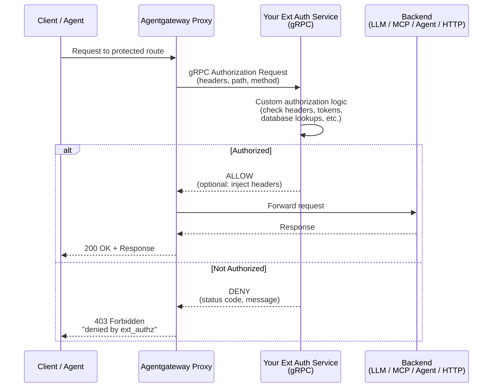

Bring your own external authorization service to protect requests that go through your Gateway.

## About external auth {#about}

 lets you integrate your own external authorization service to your Gateway. Then, this external authorization service makes authorization decisions for requests that go through the Gateway, as shown in the following diagram.

Review the following diagram to understand the flow of a request: 



## Before you begin 



> [!NOTE]
> Note that this guide assumes that you want to apply the policy to the OpenAI LLM provider. You can use other LLM providers or apply external auth to an MCP server, agents, and Kubernetes services. Make sure to adjust these steps to apply to your  type or Kubernetes service.

## Deploy your own external authorization service {#byo-ext-auth}

Deploy your own external authorization service as a backend service that is accessible to your agentgateway proxy.

> [!NOTE]
> Keep in mind that your external authorization service must conform to the [Envoy external auth proto](https://github.com/envoyproxy/envoy/blob/main/api/envoy/service/auth/v3/external_auth.proto). The external authorization service also configures the conditions for authorizing a request, such as the inclusion of a certain header or other credentials.

1. Deploy your external authorization service. The following example uses the [Istio external authorization service](https://github.com/istio/istio/tree/master/samples/extauthz) for quick testing purposes. This service is configured to allow requests with the `x-ext-authz: allow` header.

   ```yaml
   kubectl apply -f - <<EOF
   apiVersion: apps/v1
   kind: Deployment
   metadata:
     namespace: 
     name: ext-authz
     labels:
       app: ext-authz
   spec:
     replicas: 1
     selector:
       matchLabels:
         app: ext-authz
     template:
       metadata:
         labels:
           app: ext-authz
           app.kubernetes.io/name: ext-authz
       spec:
         containers:
         - image: gcr.io/istio-testing/ext-authz:1.25-dev
           name: ext-authz
           ports:
           - containerPort: 9000
   EOF
   ```

2. Create a Service for the Deployment that your proxy can access.

   ```yaml
   kubectl apply -f - <<EOF
   apiVersion: v1
   kind: Service
   metadata:
     namespace: 
     name: ext-authz
     labels:
       app: ext-authz
   spec:
     ports:
     - port: 4444
       targetPort: 9000
       protocol: TCP
       appProtocol: kubernetes.io/h2c
     selector:
       app: ext-authz
   EOF
   ```

## Create external auth policy {#create-policy}

You can attach an external authorization policy to a Gateway, HTTPRoute, or backend (an  or a Kubernetes Service). If you attach policies at multiple levels, the request must pass each one to be authorized.

Gateway and HTTPRoute targets use the `traffic.extAuth` section so that authorization runs before the proxy selects a backend. Backend targets use the `backend.extAuth` section so that authorization runs after backend selection, which is useful when the authorization service shapes the outgoing request, for example by inserting a token, or when a route load-balances or fails over across multiple backends.


To check every request on a listener before route selection, you can also use a [listener ExternalAuth filter](#listener-filter).



For gRPC external authorization, agentgateway waits 2 seconds for the authorization service to respond by default. To use a different timeout, apply a second  whose `targetRefs` names the authorization service, either as a Kubernetes Service or as an , and set `backend.http.requestTimeout` on it.


1. Send a test request to the OpenAI backend. Verify that you get back a 200 HTTP response code and that no authorization is required.

   
   {}
   ```sh
   curl -v "${INGRESS_GW_ADDRESS}/openai" -H content-type:application/json -d '{
    "model": "gpt-3.5-turbo",
    "messages": [
      {
        "role": "system",
        "content": "You are a poetic assistant, skilled in explaining complex programming concepts with creative flair."
      },
      {
        "role": "user",
        "content": "Write 5 sentences."
      }
    ]
   }'
   ```
   {}
   {}
   ```sh
   curl -v "localhost:8080/openai" -H content-type:application/json -d '{
    "model": "gpt-3.5-turbo",
    "messages": [
      {
        "role": "system",
        "content": "You are a poetic assistant, skilled in explaining complex programming concepts with creative flair."
      },
      {
        "role": "user",
        "content": "Write 5 sentences."
      }
    ]
   }'
   ```
   {}
   

   Example output: 
   
   ```txt
   HTTP/1.1 200 OK
   ...
   ```

2. Create an  that references the external authorization service. Choose the tab for the target you want to attach the policy to. The Gateway and HTTPRoute tabs apply external authorization before backend selection. The  tab applies it after backend selection.

   
   {}
   ```yaml
   kubectl apply -f - <<EOF
   apiVersion: 
   kind: 
   metadata:
     namespace: 
     name: gateway-ext-auth-policy
     labels:
       app: ext-authz
   spec:
     targetRefs:
     - group: gateway.networking.k8s.io
       kind: Gateway
       name: agentgateway-proxy
     traffic:
       extAuth:
         backendRef:
           name: ext-authz
           namespace: 
           port: 4444
         cache:
           key:
             - request.path
             - request.headers["authorization"]
           ttl: 5m
           maxEntries: 10000
         grpc: {}
   EOF
   ```
   {}
   {}
   ```yaml
   kubectl apply -f - <<EOF
   apiVersion: 
   kind: 
   metadata:
     namespace: 
     name: route-ext-auth-policy
     labels:
       app: ext-authz
   spec:
     targetRefs:
     - group: gateway.networking.k8s.io
       kind: HTTPRoute
       name: openai
     traffic:
       extAuth:
         backendRef:
           name: ext-authz
           namespace: 
           port: 4444
         cache:
           key:
             - request.path
             - request.headers["authorization"]
           ttl: 5m
           maxEntries: 10000
         grpc: {}
   EOF
   ```
   {}
   {}
   
   Backend-level policies can also target a Kubernetes Service. To target a Service, set `kind: Service` and `group: ""` in `targetRefs`, and use the same `backend.extAuth` configuration shown in the  tab.

   ```yaml
   kubectl apply -f - <<EOF
   apiVersion: 
   kind: 
   metadata:
     namespace: 
     name: backend-ext-auth-policy
     labels:
       app: ext-authz
   spec:
     targetRefs:
     - group: agentgateway.dev
       kind: AgentgatewayBackend
       name: openai
     backend:
       extAuth:
         backendRef:
           name: ext-authz
           port: 4444
         cache:
           key:
             - request.path
             - request.headers["authorization"]
           ttl: 5m
           maxEntries: 10000
         grpc: {}
   EOF
   ```
   {}
   

3. Repeat your request to the OpenAI backend and verify that the request is denied.

   
   {}
   ```sh
   curl -v "${INGRESS_GW_ADDRESS}/openai" -H content-type:application/json -d '{
    "model": "gpt-3.5-turbo",
    "messages": [
      {
        "role": "system",
        "content": "You are a poetic assistant, skilled in explaining complex programming concepts with creative flair."
      },
      {
        "role": "user",
        "content": "Write 5 sentences."
      }
    ]
   }'
   ```
   {}
   {}
   ```sh
   curl -v "localhost:8080/openai" -H content-type:application/json -d '{
    "model": "gpt-3.5-turbo",
    "messages": [
      {
        "role": "system",
        "content": "You are a poetic assistant, skilled in explaining complex programming concepts with creative flair."
      },
      {
        "role": "user",
        "content": "Write 5 sentences."
      }
    ]
   }'
   ```
   {}
   

   Example output: Note the 403 Forbidden response, along with the special `x-ext-authz*` headers that the Istio external authorization service adds to the request to explain the decision.
   
   ```txt
   * upload completely sent off: 268 bytes
   < HTTP/1.1 403 Forbidden
   < content-type: text/plain
   < content-length: 29
   < 
   * Connection #0 to host localhost left intact
   denied by ext_authz for not found header `x-ext-authz: allow` in the request%    
   ```

4. Send another request, this time with the `x-ext-authz: allow` header. The Istio external authorization service is configured to allow requests with this header. Therefore, the request succeeds.

   
   {}
   ```sh
   curl -v "${INGRESS_GW_ADDRESS}/openai" -H content-type:application/json \
   -H "x-ext-authz: allow" \
   -H "x-ai-api-key:N2YwMDIxZTEtNGUzNS1jNzgzLTRkYjAtYjE2YzRkZGVmNjcy" \
   -d '{
    "model": "gpt-3.5-turbo",
    "messages": [
      {
        "role": "system",
        "content": "You are a poetic assistant, skilled in explaining complex programming concepts with creative flair."
      },
      {
        "role": "user",
        "content": "Write 5 sentences."
      }
    ]
   }'
   ```
   {}
   {}
   ```sh
   curl -v "localhost:8080/openai" -H content-type:application/json \
    -H "x-ext-authz: allow" \
    -H "x-ai-api-key:N2YwMDIxZTEtNGUzNS1jNzgzLTRkYjAtYjE2YzRkZGVmNjcy" \
    -d '{
     "model": "gpt-3.5-turbo",
     "messages": [
      {
        "role": "system",
        "content": "You are a poetic assistant, skilled in explaining complex programming concepts with creative flair."
      },
      {
        "role": "user",
        "content": "Write 5 sentences."
      }
    ]
   }'
   ```
   {}
   


## Listener ExternalAuth filter {#listener-filter}

Instead of a policy, you can add an external authorization filter to a Gateway listener. The Gateway API calls this a pre-routing filter. The proxy sends every request that the listener accepts to your authorization service before it selects a route. The proxy denies an unauthorized request even if no route matches it.

> [!NOTE]
> Listener filters require the experimental channel of Gateway API version 1.7 or later. For the install command, see [Experimental features in Gateway API]().

1. Add the `ExternalAuth` filter to the `filters.requests` field of a listener. The following example uses the `ext-authz` service that you deployed earlier. This command replaces the `agentgateway-proxy` Gateway. If you changed that Gateway, add the `filters` field to its listener instead of applying this manifest.

   ```yaml
   kubectl apply -f- <<EOF
   apiVersion: gateway.networking.k8s.io/v1
   kind: Gateway
   metadata:
     name: agentgateway-proxy
     namespace: 
   spec:
     gatewayClassName: 
     listeners:
     - name: http
       port: 80
       protocol: HTTP
       allowedRoutes:
         namespaces:
           from: All
       filters:
         requests:
         - type: ExternalAuth
           externalAuth:
             protocol: GRPC
             grpc: {}
             backendRef:
               name: ext-authz
               port: 4444
   EOF
   ```

   

   | Field | Description |
   |-------|-------------|
   | `filters.requests[].type` | The type of the filter. Agentgateway supports only `ExternalAuth`. |
   | `externalAuth.protocol` | The protocol that the authorization service speaks, either `GRPC` or `HTTP`. For `GRPC`, set `grpc`. For `HTTP`, set `http`. |
   | `externalAuth.backendRef` | The Service of the authorization service. If the Service is in another namespace, create a [ReferenceGrant](https://gateway-api.sigs.k8s.io/api-types/referencegrant/) from the Gateway to the Service. |

2. Verify that the controller accepted the listener and resolved the filter.

   ```sh
   kubectl get gateway agentgateway-proxy -n  \
     -o jsonpath='{range .status.listeners[*].conditions[*]}{.type}={.status} {.reason}{"\n"}{end}'
   ```

   Example output:

   ```txt
   Accepted=True Accepted
   Conflicted=False NoConflicts
   Programmed=True Programmed
   ResolvedRefs=True ResolvedRefs
   ```

3. Send a request to a path that no route matches, without the `x-ext-authz` header. Because the filter runs before route selection, the proxy returns a `403` response from the authorization service instead of a `404` response.

   
   {}
   ```sh
   curl -i "${INGRESS_GW_ADDRESS}/no-such-route"
   ```
   {}
   {}
   ```sh
   curl -i "localhost:8080/no-such-route"
   ```
   {}
   

   Example output:

   ```txt
   HTTP/1.1 403 Forbidden
   x-ext-authz-check-result: denied
   ...

   denied by ext_authz for not found header `x-ext-authz: allow` in the request
   ```

4. Repeat the request with the `x-ext-authz: allow` header. The authorization service allows the request, and the proxy then finds no matching route.

   
   {}
   ```sh
   curl -i "${INGRESS_GW_ADDRESS}/no-such-route" -H "x-ext-authz: allow"
   ```
   {}
   {}
   ```sh
   curl -i "localhost:8080/no-such-route" -H "x-ext-authz: allow"
   ```
   {}
   

   Example output:

   ```txt
   HTTP/1.1 404 Not Found
   content-type: text/plain
   ...

   route not found
   ```

Review the following limits for listener filters.

* **One filter only**: A listener can have only one `ExternalAuth` filter. If you add a second one, the `Accepted` condition of the listener is `False` with the `InvalidListenerFilter` reason.
* **Type**: Other filter types, such as `ExtensionRef`, are not supported. The `Accepted` condition of the listener is `False` with the `UnsupportedValue` reason.
* **References**: If the `backendRef` cannot be resolved, the `ResolvedRefs` condition is `False` with the `InvalidListenerFilterRef` reason. If the Service is in another namespace and no ReferenceGrant allows the Gateway to reference it, the reason is `RefNotPermitted`.

Listener filters work the same way on listeners of a ListenerSet.


## Cleanup




If you added the listener filter, remove it from the Gateway before you delete the `ext-authz` Service. Otherwise, the filter's `backendRef` no longer resolves, the listener is no longer programmed, and the Gateway stops serving traffic.

```sh
kubectl patch gateway agentgateway-proxy -n  --type=json \
  -p='[{"op":"remove","path":"/spec/listeners/0/filters"}]'
```

Example output:

```txt
gateway.gateway.networking.k8s.io/agentgateway-proxy patched
```


```sh
kubectl delete  gateway-ext-auth-policy route-ext-auth-policy backend-ext-auth-policy -n  --ignore-not-found
kubectl delete deployment ext-authz -n 
kubectl delete service ext-authz -n 
```
