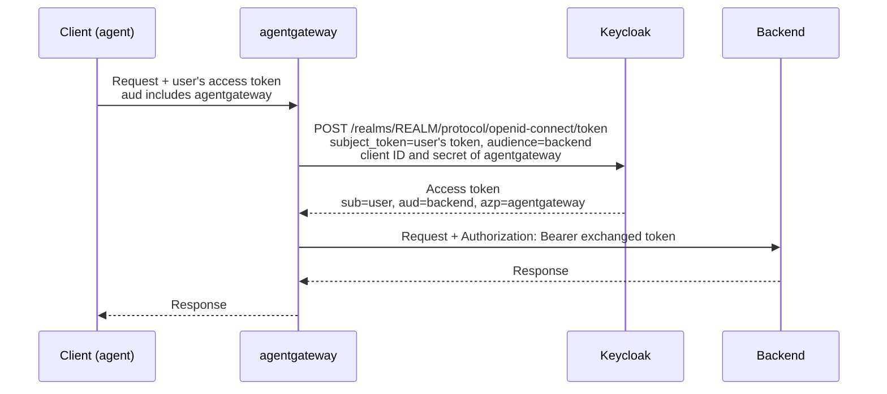

Keycloak implements the RFC 8693 token exchange grant as [standard token exchange](https://www.keycloak.org/securing-apps/token-exchange#_standard-token-exchange), which is supported in Keycloak 26.2 and later and is turned on per client. The gateway is a confidential client of the realm. It sends the user's access token as the `subject_token`, and Keycloak returns a new access token for the same user (`sub`), issued for the backend's audience, with the gateway's client as the authorized party (`azp`).

The guide uses three Keycloak clients.

- `agent` is the caller. It signs in the user and gets the user's token, called the incoming token. In the test realm, you play this client yourself and use `curl` to get the token.
- `agentgateway` is the gateway. It sends the incoming token to Keycloak and gets the exchanged token back.
- `backend` represents the backend API. Keycloak issues the exchanged token for this audience, and the gateway sends the token to the backend.

Keycloak checks two audiences during the exchange.

- The incoming token must list `agentgateway` in its `aud` claim.
- `agentgateway` must be allowed to get `backend` in its own tokens.

The {}[standard token exchange guide](){}{}[standard token exchange guide](){} runs this exchange end to end against a sample Keycloak realm that comes preconfigured. This guide shows the realm settings that make the exchange work, so that you can set up your own realm.
