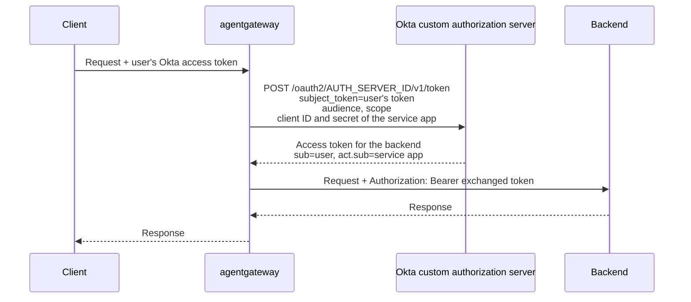

Okta implements the RFC 8693 token exchange grant as [On-Behalf-Of Token Exchange](https://developer.okta.com/docs/guides/set-up-token-exchange/main/). A service app sends a user's access token from a custom authorization server as the `subject_token`, and Okta returns a new access token for the same user, issued for the audience and scopes that the service app requests. The new token names the user in its `sub` claim and the service app in its `act` claim, so the backend knows both who the request is for and who is acting for them.

In this guide, agentgateway is the service app. The client sends the user's Okta access token to the gateway, and the gateway exchanges it for each request to the backend. The backend receives a token that was issued for its own audience and scopes, not the token that the client sent.

Unlike the Google Security Token Service, Okta authenticates the caller of the exchange. The gateway needs the client ID and client secret of an Okta API Services app that has the Token Exchange grant.
