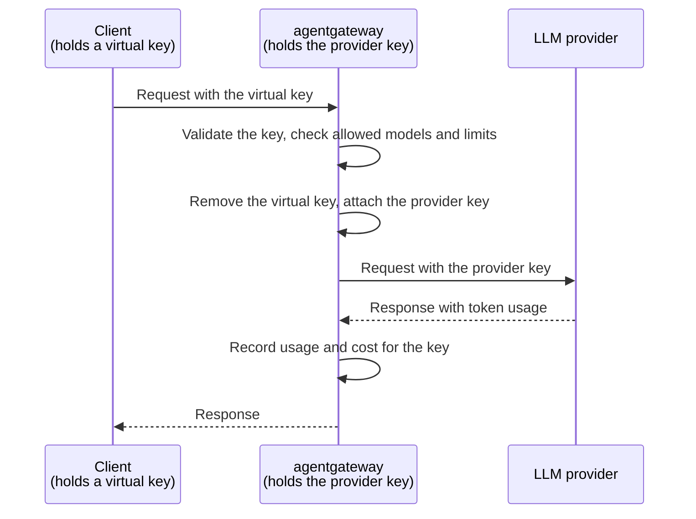

Keep your LLM provider API keys on agentgateway, and give each coding agent, tool, or user a virtual key that you can revoke.

## About

Coding agents such as OpenCode, Codex, and Claude Code usually authenticate with a provider API key, such as an OpenAI or Anthropic key. That key ends up in a config file or environment variable on every laptop, CI runner, and workspace where the agent runs. When the provider asks you to rotate the key, or a copy leaks, you have to find and replace every copy.

With agentgateway in front of your LLM providers, the provider keys stay on the gateway host. Each client gets a virtual key instead. A virtual key works only against agentgateway, and you can revoke it without affecting any other client.



When a request arrives, agentgateway does the following:

1. Validates the virtual key. A missing, unknown, or revoked key gets a `401` response.
2. Applies the policies for that key, such as which models the key can use and how many tokens it can spend.
3. Removes the virtual key from the request and attaches the provider key. The provider never receives the virtual key, and the client never sees the provider key.
4. Records the token usage and cost of the request, which you can attribute to the user of each key.

Because the provider keys live in one place, routine and emergency changes happen on the gateway only.

| When you need to | Change on the gateway | Change on clients |
| -- | -- | -- |
| Rotate a provider key | Replace the key file. | None. |
| Revoke a client | Remove its virtual key. Its next request gets a `401` response. | None for other clients. |
| Limit the damage from a copied virtual key | Set a rate limit or budget for each key. | None. |
| Allow only some models | List the models that the gateway serves, or that each key can use. | None. |

### More security considerations

This pattern does not remove the risk of a leaked key. It moves the provider keys to one host that you control. The gateway host holds every provider key, so protect it as you would any other secret store.

* **Restrict access to the files.** Run agentgateway as a dedicated user, and make the key file and the configuration file readable only by that user.
* **Do not store raw virtual keys.** Store a `keyHash` for each virtual key instead of the raw `key`, so that a copy of the configuration file does not contain usable keys.
* **Encrypt client traffic.** Virtual keys are bearer credentials. Serve clients over TLS, or keep the gateway on a private network.
* **Protect the UI and admin API.** Anyone who can reach them can create and read virtual keys. For more information, see [Secure the UI]().
* **Keep agentgateway up to date** with security patches.

## Before you begin



You also need an API key for your LLM provider. This guide uses OpenAI and stores the key in a file. For other options of providing the API key to agentgateway, see [Provider API keys]().

## Step 1: Store the provider key on the gateway host

Save the provider key in a file that only the user who runs agentgateway can read. Agentgateway watches the file, so you can later rotate the key by replacing the contents of the file.

```sh
printf '%s' "$OPENAI_API_KEY" > openai-key
chmod 600 openai-key
```

## Step 2: Configure virtual keys

Create a configuration that defines the virtual keys for your users, and that reads the provider key from the file. This example creates virtual keys for Alice and Bob. Bob's key can use only the `gpt-4o-mini` model.

```yaml
cat <<'EOF' > config.yaml
# yaml-language-server: $schema=https://agentgateway.dev/schema/config
frontendPolicies:
  accessLog:
    add:
      user: apiKey.user

llm:
  policies:
    apiKey:
      mode: strict
      keys:
      - key: vk-alice-4f9c2a
        metadata:
          user: alice
      - key: vk-bob-8d1e7b
        metadata:
          user: bob
        allowedModels:
        - gpt-4o-mini
    localRateLimit:
    - maxTokens: 10000
      tokensPerFill: 10000
      fillInterval: 60s
      type: tokens
      key: apiKey.user
  providers:
  - name: openai
    provider: openAI
    defaults:
      auth:
        key:
          value:
            file: openai-key
  models:
  - name: gpt-4o-mini
    provider:
      reference: openai
  - name: gpt-4o
    provider:
      reference: openai
EOF
```

{}

| Setting | Description |
| -- | -- |
| `frontendPolicies.accessLog.add.user` | Adds the `user` metadata of the virtual key to each request log, so that you can attribute token usage and cost to a user. |
| `apiKey.mode` | Set to `strict` so that every request needs a valid virtual key. |
| `apiKey.keys` | The virtual keys that clients send in the `Authorization: Bearer <key>` header. To keep usable keys out of the config file, store a SHA-256 hash of each key in a `keyHash` field instead of the raw `key`. For more information, see [API key authentication](). |
| `metadata.user` | The user of the key, which the rate limit and the request log read as `apiKey.user`. |
| `allowedModels` | The models that the key can use. A request for any other model gets a `403` response. Omit the field to allow all the models that the gateway serves. |
| `localRateLimit` | A token budget of 10,000 tokens per minute. The `key: apiKey.user` setting gives each user a separate budget, so a copied key cannot use up the budget of other users. To cap spend in US dollars instead, see [Per-key budgets](). |
| `providers` | Defines the OpenAI provider once, so that every model that references it uses the same provider key. |
| `defaults.auth.key.value.file` | The file that holds the provider key. Agentgateway reloads the key when the file changes. A relative path resolves from the directory where you start agentgateway, so use an absolute path in production. |
| `models` | The models that the gateway serves. A request for a model that is not in the list gets a `404` response. Avoid the `*` wildcard if you want to control which models clients can use. |

## Step 3: Start agentgateway

```sh
agentgateway -f config.yaml
```

## Step 4: Connect a client with a virtual key

Give each client the gateway address and its virtual key, instead of a provider key. Most clients accept a custom base URL for an OpenAI-compatible API, such as `http://localhost:4000/v1`, and an API key. For example, see the guides for [OpenCode](), [Codex](), and [other LLM clients]().

1. Send a request with Alice's virtual key. The request succeeds.

   ```sh
   curl -s http://localhost:4000/v1/chat/completions \
     -H "Authorization: Bearer vk-alice-4f9c2a" \
     -H "Content-Type: application/json" \
     -d '{"model": "gpt-4o", "messages": [{"role": "user", "content": "Hello!"}]}' | jq .
   ```

   In the agentgateway logs, the request log shows the user, the token usage, and the cost of the request.

   ```
   info  request gateway=default/default listener=llm route=internal/llm:request endpoint=api.openai.com:443 ... http.status=200 protocol=llm gen_ai.operation.name=chat gen_ai.provider.name=openai gen_ai.request.model=gpt-4o gen_ai.response.model=gpt-4o-2024-08-06 gen_ai.usage.input_tokens=9 gen_ai.usage.output_tokens=10 agw.ai.usage.cost.total=0.0001225 duration=640ms user="alice"
   ```

2. Send a request with Bob's virtual key for the `gpt-4o` model. Bob's key is not allowed to use that model, so the request is rejected with a `403` response.

   ```sh
   curl -s http://localhost:4000/v1/chat/completions \
     -H "Authorization: Bearer vk-bob-8d1e7b" \
     -H "Content-Type: application/json" \
     -d '{"model": "gpt-4o", "messages": [{"role": "user", "content": "Hello!"}]}'
   ```

   Example output:

   ```json
   {"error":{"message":"Model is not allowed for this API key","type":"invalid_request_error","code":"model_not_allowed"}}
   ```

3. Send a request for a model that the gateway does not serve, such as `o3`. The request is rejected with a `404` response, even though the provider key could use that model.

   ```sh
   curl -s http://localhost:4000/v1/chat/completions \
     -H "Authorization: Bearer vk-alice-4f9c2a" \
     -H "Content-Type: application/json" \
     -d '{"model": "o3", "messages": [{"role": "user", "content": "Hello!"}]}'
   ```

   Example output:

   ```json
   {"error":{"message":"Model not found","type":"invalid_request_error","code":"model_not_found"}}
   ```

## Step 5: Rotate and revoke keys

Make the following changes on the gateway host while agentgateway runs. You do not need to restart agentgateway or change the configuration of any client.

* **Rotate the provider key**: Replace the contents of the key file. Agentgateway sends the new key with the next request. After you verify that requests still succeed, revoke the old key in the console of your provider.

  ```sh
  printf '%s' "$NEW_OPENAI_API_KEY" > openai-key
  ```

* **Revoke a virtual key**: Remove the key from the `apiKey.keys` list in `config.yaml` and save the file. Agentgateway reloads the configuration, and the next request with that key gets a `401` response. For example, to revoke Bob's key, the list keeps only Alice's key.

  ```yaml
  keys:
  - key: vk-alice-4f9c2a
    metadata:
      user: alice
  ```

  Then send a request with Bob's key.

  ```sh
  curl -s -o /dev/null -w "%{http_code}\n" http://localhost:4000/v1/chat/completions \
    -H "Authorization: Bearer vk-bob-8d1e7b" \
    -H "Content-Type: application/json" \
    -d '{"model": "gpt-4o-mini", "messages": [{"role": "user", "content": "Hello!"}]}'
  ```

  Example output:

  ```
  401
  ```

You can also create, edit, and delete virtual keys in the [UI](). For more information, see [Virtual key management]().

## Next steps


  
  
  

