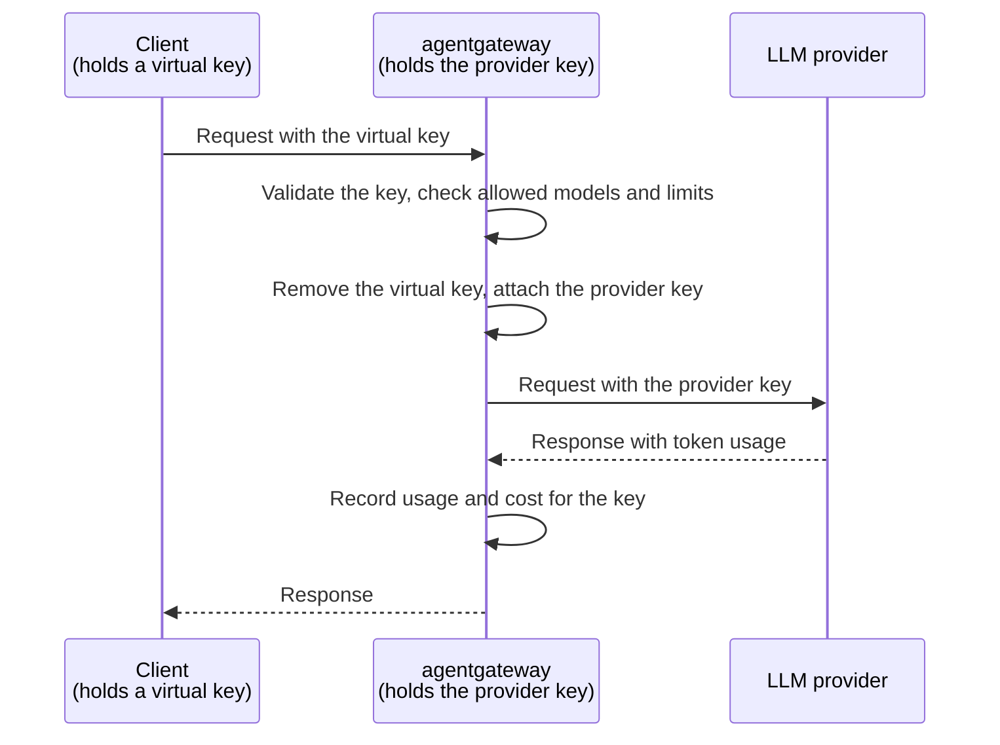

Keep LLM provider API keys on agentgateway. Give each client a revocable virtual key.

## About

When clients use a provider API key directly, each laptop, CI runner, or workspace stores a copy. Rotating the key means finding and replacing every copy.

With agentgateway, provider keys stay on the gateway host. Clients receive virtual keys that work only with agentgateway. You can revoke each virtual key independently.



The provider never receives the virtual key, and the client never receives the provider key. Manage access on the gateway without reconfiguring clients:

| Task | Change on the gateway |
| -- | -- |
| Rotate a provider key | Replace the key file. |
| Revoke a client | Remove its virtual key. Its next request gets a `401` response. |
| Limit usage of a copied virtual key | Set a rate limit or budget for each key. |
| Restrict model access | List the models that the gateway serves or that each key can use. |

### More security considerations

The gateway host holds every provider key. Protect it as you would any other secret store.

* **Restrict access to the files.** Run agentgateway as a dedicated user, and make the key file and the configuration file readable only by that user.
* **Do not store raw virtual keys.** Store a `keyHash` for each virtual key instead of the raw `key`, so that a copy of the configuration file does not contain usable keys.
* **Encrypt client traffic.** Virtual keys are bearer credentials. Serve clients over TLS, or keep the gateway on a private network.
* **Protect the UI and admin API.** Anyone who can reach them can create and read virtual keys. For more information, see [Secure the UI]().
* **Keep agentgateway up to date** with security patches.

## Before you begin



You also need an OpenAI API key. This guide stores it in a file. For other ways to provide the key, see [Provider API keys]().

## Step 1: Store the provider key on the gateway host

Save the provider key in a file readable only by the user who runs agentgateway. Agentgateway watches this file for changes.

```sh
printf '%s' "$OPENAI_API_KEY" > openai-key
chmod 600 openai-key
```

## Step 2: Configure virtual keys

Configure agentgateway to read the provider key file and accept virtual keys for Alice and Bob. Bob can use only `gpt-4o-mini`.

```yaml
cat <<'EOF' > config.yaml
# yaml-language-server: $schema=https://agentgateway.dev/schema/config
frontendPolicies:
  accessLog:
    add:
      user: apiKey.user

llm:
  policies:
    apiKey:
      mode: strict
      keys:
      - key: vk-alice-4f9c2a
        metadata:
          user: alice
      - key: vk-bob-8d1e7b
        metadata:
          user: bob
        allowedModels:
        - gpt-4o-mini
    localRateLimit:
    - maxTokens: 10000
      tokensPerFill: 10000
      fillInterval: 60s
      type: tokens
      key: apiKey.user
  providers:
  - name: openai
    provider: openAI
    defaults:
      auth:
        key:
          value:
            file: openai-key
  models:
  - name: gpt-4o-mini
    provider:
      reference: openai
  - name: gpt-4o
    provider:
      reference: openai
EOF
```

{}

| Setting | Description |
| -- | -- |
| `frontendPolicies.accessLog.add.user` | Adds the key's `user` metadata to request logs to track usage and cost per user. |
| `apiKey.mode` | Set to `strict` so that every request needs a valid virtual key. |
| `apiKey.keys` | The virtual keys that clients send in the `Authorization: Bearer <key>` header. |
| `metadata.user` | The user of the key, which the rate limit and the request log read as `apiKey.user`. |
| `allowedModels` | The models that the key can use. A request for any other model gets a `403` response. Omit the field to allow all the models that the gateway serves. |
| `localRateLimit` | A budget of 10,000 tokens per minute for each `apiKey.user`. A copied key cannot consume another user's budget. |
| `providers` | Defines a shared OpenAI provider and key for the models that reference it. |
| `defaults.auth.key.value.file` | The provider key file. Relative paths resolve from the directory where you start agentgateway. Use an absolute path in production. |
| `models` | The models that the gateway serves. Unlisted models get a `404` response. Avoid `*` to restrict model access. |

To store hashes instead of raw virtual keys, use `keyHash` as described in [API key authentication](). To cap spend in US dollars, see [Per-key budgets]().

## Step 3: Start agentgateway

```sh
agentgateway -f config.yaml
```

## Step 4: Connect a client with a virtual key

Configure your client with its virtual key and the gateway base URL, `http://localhost:4000/v1`.

For client-specific instructions, see [OpenCode](), [Codex](), or [other LLM clients]().

1. Send a request with Alice's virtual key. The request succeeds.

   ```sh
   curl -s http://localhost:4000/v1/chat/completions \
     -H "Authorization: Bearer vk-alice-4f9c2a" \
     -H "Content-Type: application/json" \
     -d '{"model": "gpt-4o", "messages": [{"role": "user", "content": "Hello!"}]}' | jq .
   ```

   The request log shows the user, token usage, and cost.

   ```
   info  request gateway=default/default listener=llm route=internal/llm:request endpoint=api.openai.com:443 ... http.status=200 protocol=llm gen_ai.operation.name=chat gen_ai.provider.name=openai gen_ai.request.model=gpt-4o gen_ai.response.model=gpt-4o-2024-08-06 gen_ai.usage.input_tokens=9 gen_ai.usage.output_tokens=10 agw.ai.usage.cost.total=0.0001225 duration=640ms user="alice"
   ```

2. Request `gpt-4o` with Bob's key. Agentgateway returns `403` because his key allows only `gpt-4o-mini`.

   ```sh
   curl -s http://localhost:4000/v1/chat/completions \
     -H "Authorization: Bearer vk-bob-8d1e7b" \
     -H "Content-Type: application/json" \
     -d '{"model": "gpt-4o", "messages": [{"role": "user", "content": "Hello!"}]}'
   ```

   Example output:

   ```json
   {"error":{"message":"Model is not allowed for this API key","type":"invalid_request_error","code":"model_not_allowed"}}
   ```

3. Request an unlisted model, such as `o3`. Agentgateway returns `404`, even if the provider key allows that model.

   ```sh
   curl -s http://localhost:4000/v1/chat/completions \
     -H "Authorization: Bearer vk-alice-4f9c2a" \
     -H "Content-Type: application/json" \
     -d '{"model": "o3", "messages": [{"role": "user", "content": "Hello!"}]}'
   ```

   Example output:

   ```json
   {"error":{"message":"Model not found","type":"invalid_request_error","code":"model_not_found"}}
   ```

## Step 5: Rotate and revoke keys

Make the following changes on the gateway host while agentgateway runs. You do not need to restart agentgateway or change the configuration of any client.

* **Rotate the provider key**: Replace the contents of the key file. Agentgateway sends the new key with the next request. After you verify that requests still succeed, revoke the old key in the console of your provider.

  ```sh
  printf '%s' "$NEW_OPENAI_API_KEY" > openai-key
  ```

* **Revoke a virtual key**: Remove the key from `apiKey.keys` in `config.yaml` and save the file. Agentgateway reloads the configuration. To revoke Bob's key, keep only Alice's key:

  ```yaml
  keys:
  - key: vk-alice-4f9c2a
    metadata:
      user: alice
  ```

  Then send a request with Bob's key.

  ```sh
  curl -s -o /dev/null -w "%{http_code}\n" http://localhost:4000/v1/chat/completions \
    -H "Authorization: Bearer vk-bob-8d1e7b" \
    -H "Content-Type: application/json" \
    -d '{"model": "gpt-4o-mini", "messages": [{"role": "user", "content": "Hello!"}]}'
  ```

  Example output:

  ```
  401
  ```

You can also create, edit, and delete virtual keys in the [UI](). For more information, see [Virtual key management]().

## Next steps


  
  
  

