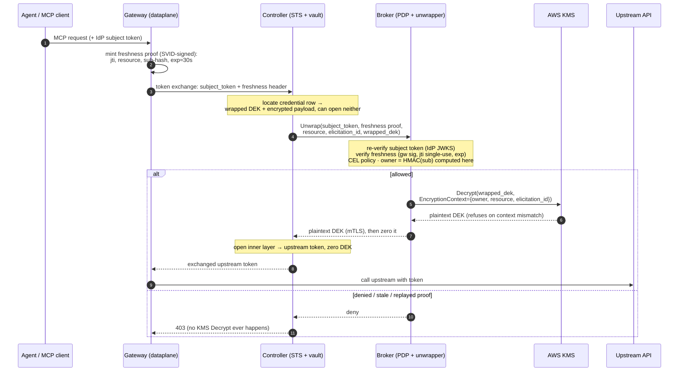

We've been digging into credential shielding/brokering for AI agents typically in the egress/outbound direction. In [part 1](/blog/2026-07-27-credential-injection-ai-agent-egress-cb4a/) I introduced the approaches discussed in the [CB4A paper](https://datatracker.ietf.org/doc/html/draft-hartman-credential-broker-4-agents-00) which lead us to an uncomfortable place: lots of credentials centralized into a token vault.

In [part 2](/blog/2026-08-03-protecting-token-vault-kms-credential-injection/) I walked through three ways to protect the token vault behind a credential broker, and landed on "Mode 3": the controller (the STS that owns the vault) keeps the ciphertext, has `kms:Encrypt` and loses `kms:Decrypt` entirely. Every unwrap needs a short-lived AWS KMS grant minted by a separate decision broker. The controller alone can't read/decrypt anything, the broker can decrypt but has nothing to read (no DB access), and a compromised controller can't mass decrypt the store. That's the property we want to keep.



In this blog I want to look at the part of that design that falls over under real load (the KMS grant), and useful alternatives. It's a short one, but it changes the recommendation I made at the end of part 2.

## KMS grants don't scale

When I posted part 2, [Stephane Nangue](https://www.linkedin.com/in/stephane-nangue-480a2557/) pushed back [in the comments](https://www.linkedin.com/posts/ceposta_credentials-vault-security-share-7490393823735566336-FWmz/) on two things. The second (per-user scoping is broker code rather than IAM) is now addressed in [updates to part 2](/blog/2026-08-03-protecting-token-vault-kms-credential-injection/) itself. The first is simple: Mode 3 doesn't scale, and the workarounds (caching, session-scoped grants, etc) put the standing decrypt right back. He's right.

So how bad is it? If you look at the [KMS request quotas](https://docs.aws.amazon.com/kms/latest/developerguide/requests-per-second.html), `CreateGrant` and `RetireGrant` default to 50 requests per second, per account, per region, while the shared symmetric `Decrypt` quota is 10,000 to 100,000 per second depending on the region. All of these are adjustable, but every token exchange in Mode 3 is three KMS calls (`CreateGrant`, `Decrypt`, `RetireGrant`), so the mint rate is the ceiling for the whole system, and it's a ceiling you share with every AWS service in the account that mints grants on your behalf (e.g. EBS creates one per encrypted volume attach). A shared enterprise gateway exchanging on every tool call will find 50 a second pretty quickly.

Grants are also durable. They don't expire, [somebody has to retire them](https://docs.aws.amazon.com/kms/latest/developerguide/grant-delete.html), and each key holds at most [50,000](https://docs.aws.amazon.com/kms/latest/developerguide/resource-limits.html#grants-per-key). A broker crash, a throttled `RetireGrant`, a bug in the retirement path, etc leaves grants stranded, and at the mint ceiling you fill the key in about 17 minutes, at which point `CreateGrant` returns `LimitExceededException` and every token exchange in the environment fails. And every grant that doesn't get retired is now "hidden" .. and becomes a row the controller can decrypt whenever it wants until someone notices. So if retirement is failing in the background you've basically drifted back to Mode 2 for every one of those rows, or worse (reaching limits and not issuing new grants -- crashes the system).

## What if the broker calls Decrypt itself?

We don't have to limit to the decrypt grant we send to the controller. We can flip who calls `Decrypt`. The broker gets standing `kms:Decrypt` but never touches the ciphertext, and the controller keeps the ciphertext with no `kms:Decrypt` at all. The controller still can't read a row on its own and the broker still has nothing to read, but instead of minting a grant and handing it back, the broker unwraps the DEK itself and returns it to the controller.

Let's walk through what the controller sends and what it gets back.

The controller sends the subject token, the freshness proof, the resource, the elicitation id, and the wrapped DEK. It does not send the encrypted payload, so the broker never sees a credential, only key material. The broker runs exactly the checks it ran in Mode 3: subject token signature and expiry against the IdP JWKS, freshness proof against the gateway's SVID, single-use `jti`, CEL policy, honeytoken rows, etc. Then it computes `owner = HMAC(sub)` from the subject token *it just verified*, builds the `EncryptionContext` from that, and calls `Decrypt`.

The broker never accepts an `EncryptionContext` from the controller. If the controller hands over Bob's wrapped DEK while presenting Alice's subject token, the broker presents Alice's `owner` and KMS fails the AAD check, same as it would have under a grant. KMS still enforces the owner binding, the broker just doesn't need a grant object to get there. CloudTrail still records `owner`/`resource`/`elicitation_id` on every decrypt, now under the broker's role instead of the controller's, and you join that against the broker's own decision log (neither of which lives in the controller). That's actually a cleaner audit story than Mode 3, because the controller has no business calling `Decrypt` at all, so any attempt from its identity is an attack by definition.

The DEK comes back over the mTLS connection between broker and controller, the controller opens the inner AES-GCM layer with it, hands the upstream token to the gateway, and zeroes the DEK. A DEK is per row and per write, so the controller holding one for the length of a request gets it exactly one credential.

Here's who holds what after the flip:

| Component | Holds | Cannot |
|---|---|---|
| **Controller** | ciphertext, the DB, the inner-layer decrypt once it has a DEK | call `kms:Decrypt`, reach the KEK |
| **Broker** | `kms:Decrypt`, IdP JWKS, gateway trust bundle, the owner HMAC key, policy | reach the DB, see ciphertext, see a credential payload |
| **KMS** | the KEK | application data |

## What do we give up?

For the threat this series is about (a fully compromised controller), this is equivalent to Mode 3. The controller has every ciphertext and no way to open any of it without a broker "yes". The broker won't say yes without a live gateway proof and harvested subject tokens are still worthless without presence. What you get is one `Decrypt` per exchange against a quota that runs at tens of thousands per second, and no durable grants to clean up (so no retirement job that can fall behind without anyone noticing).

But there are real costs to this:

- **Broker compromise gets worse.** In Mode 3 a compromised broker can mint grants for anyone, but the grantee pin means it still needs the controller's identity *and* its ciphertext to read a row, ie, a second compromise. Here the broker holds standing `Decrypt`, so it only needs the ciphertext, and a DB read is a much lower bar than owning the controller. The broker has no DB access and never sees ciphertext, which means the only thing between a compromised broker and the whole store is that it can't reach the database. So the network path between broker and database (e.g. separate VPC/security groups, NetworkPolicy, no shared DB credentials, service mesh, etc) should be deny-all.
- **The DEK crosses a process boundary in plaintext (over mTLS).** In Mode 3 the DEK goes straight from KMS to the controller, and here it goes KMS to broker to controller. It's one 32-byte key for one row, over mTLS, and zeroed after use, but that's still a second process holding key material, even if only briefly.
- **"Neither alone" now only holds in one direction.** In Mode 3 neither the controller nor the broker could read a row by itself. In this variant the controller still can't, but the broker can if it ever gets its hands on ciphertext.

## Where this leaves the series

I still think Mode 3 is the right design/architecture. The "yes" to decrypt lives somewhere the ciphertext doesn't. On AWS, though, the KMS grant is the wrong primitive to carry that "yes" at scale, so if I were building this today I'd have the broker call `Decrypt` itself and spend real effort keeping the broker away from the database. Part 3 rebuilds Mode 3 on Vault/OpenBAO, where this particular problem looks different, but the broker-compromise risk above shows up there too, for the same reason. If you see a hole in this, tell me (Stephane did, which is why this post exists). Follow along / [connect on LinkedIn](https://linkedin.com/in/ceposta) if you are working through credential isolation for agent egress in your own stack.
