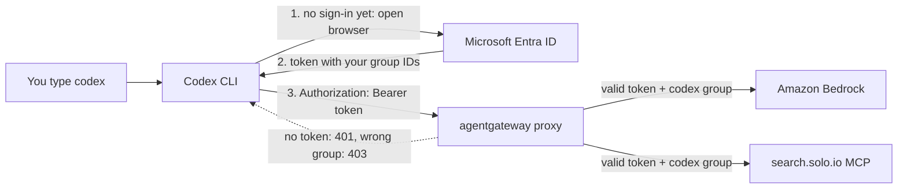

In [Part 1](/blog/2026-11-18-deploy-codex-cli-bedrock-agentgateway/) I put Codex CLI behind open source agentgateway so it could use an OpenAI model on Amazon Bedrock without holding a key. That left one obvious hole: the gateway took requests from anyone who could reach the port.

This post closes it. When I type `codex` now, it sends me to the Microsoft sign-in page first. The gateway only accepts my requests if I come back with an Entra ID token **and** I am in the `codex` group.



What you end up with:

- **Codex asks for a sign-in.** No valid sign-in, no session. Codex opens the Entra page itself.
- **Group-based access.** A valid token is not enough. The token must list the `codex` group, or the gateway answers 403.
- **One rule for the model and the MCP server.** The same check covers `/v1` (Bedrock) and `/mcp` (the Solo.io docs search server).
- **Logs with a name on them.** Each call in the agentgateway UI shows who sent it, the prompt and the answer.

All of it is open source agentgateway v1.7.0 and Codex CLI 0.170.0. The full step list with every command is in the repo: [sebbycorp/agentgateway-oss-k8s, entra-id/README.md](https://github.com/sebbycorp/agentgateway-oss-k8s/blob/main/entra-id/README.md).

## How it fits together



Three parts have to agree:

| Part | What it does |
|---|---|
| Entra app registration | Issues tokens for "the gateway", with the user's group IDs inside |
| agentgateway policy | Checks the token's signature, issuer, audience and group |
| Codex profile | Tells Codex where to send the user to sign in |

## What you need

- The build from the [previous post](/blog/2026-11-18-deploy-codex-cli-bedrock-agentgateway/): a kind cluster with agentgateway, one model, the `solo-search` MCP route and a Codex profile.
- The Azure CLI, signed in as someone who can create groups and app registrations. You only need it for setup.

```sh
az login
export TENANT_ID=$(az account show --query tenantId -o tsv)
export CTX=kind-agentgateway-codex
```

## Step 1: Create the group

```sh
export GROUP_ID=$(az ad group create --display-name codex --mail-nickname codex \
  --description "Access to LLMs and MCP servers through agentgateway" --query id -o tsv)

az ad group member add --group $GROUP_ID \
  --member-id $(az ad signed-in-user show --query id -o tsv)
```

## Step 2: Create the app registration

The app registration stands for the gateway. The gateway accepts only tokens that were issued for this app.

```sh
export APP_ID=$(az ad app create --display-name agentgateway-oss-codex \
  --sign-in-audience AzureADMyOrg --query appId -o tsv)
OBJECT_ID=$(az ad app show --id $APP_ID --query id -o tsv)

# Application ID URI, and put the user's security groups in the token
az ad app update --id $APP_ID --identifier-uris "api://$APP_ID" \
  --set groupMembershipClaims=SecurityGroup

# Expose one scope ("access") and issue v2.0 tokens
SCOPE_ID=$(uuidgen | tr 'A-Z' 'a-z')
az rest --method PATCH --uri "https://graph.microsoft.com/v1.0/applications/$OBJECT_ID" \
  --headers 'Content-Type=application/json' --body "{
    \"api\": {
      \"requestedAccessTokenVersion\": 2,
      \"oauth2PermissionScopes\": [{
        \"id\": \"$SCOPE_ID\", \"value\": \"access\", \"type\": \"User\", \"isEnabled\": true,
        \"adminConsentDisplayName\": \"Access agentgateway\",
        \"adminConsentDescription\": \"Call LLMs and MCP servers through agentgateway\",
        \"userConsentDisplayName\": \"Access agentgateway\",
        \"userConsentDescription\": \"Call LLMs and MCP servers through agentgateway\"
      }]
    }
  }"

# Public client (no secret) with loopback redirect URIs, so Codex can finish the sign-in
az rest --method PATCH --uri "https://graph.microsoft.com/v1.0/applications/$OBJECT_ID" \
  --headers 'Content-Type=application/json' --body '{
    "isFallbackPublicClient": true,
    "publicClient": { "redirectUris": ["http://127.0.0.1/callback", "http://localhost/callback"] }
  }'

az ad sp create --id $APP_ID
```

Four settings matter here, and each one fails in its own way if you skip it:

| Setting | If you skip it |
|---|---|
| Scope `api://<APP_ID>/access` | Codex has nothing to ask a token for |
| `requestedAccessTokenVersion: 2` | Sign-in works, but the gateway answers 401 because the issuer is the old v1 one |
| `groupMembershipClaims: SecurityGroup` | The token has no groups, so the gateway answers 403 |
| Public client redirect URIs | The browser shows `AADSTS500113: No reply address is registered` |

I hit the last one myself. I ran Codex before adding the redirect URIs and got the `AADSTS500113` page.

## Step 3: Apply the gateway policies

Two policies, in [`k8s/06-entra-auth.yaml`](https://github.com/sebbycorp/agentgateway-oss-k8s/blob/main/k8s/06-entra-auth.yaml). The first one attaches to the Gateway and covers everything:

```yaml
apiVersion: agentgateway.dev/v1alpha1
kind: AgentgatewayPolicy
metadata:
  name: entra-auth
  namespace: agentgateway-system
spec:
  targetRefs:
  - group: gateway.networking.k8s.io
    kind: Gateway
    name: agentgateway-proxy
  traffic:
    jwtAuthentication:            # who are you?  401 if the token is missing or invalid
      mode: Strict
      providers:
      - issuer: https://login.microsoftonline.com/${TENANT_ID}/v2.0
        audiences:
        - ${APP_ID}
        jwks:
          remote:
            url: https://login.microsoftonline.com/${TENANT_ID}/discovery/v2.0/keys
    authorization:                # are you allowed?  403 if not in the group
      action: Allow
      policy:
        matchExpressions:
        - '"${GROUP_ID}" in jwt.groups'
```

The second one attaches to the MCP route. It repeats the same checks and adds one block:

```yaml
      mcp:
        provider: Entra          # bridges the gaps between Entra and the MCP auth spec
        clientId: ${APP_ID}      # Entra has no dynamic client registration
        resourceMetadata:
          scopesSupported:
          - api://${APP_ID}/access
          bearerMethodsSupported:
          - header
```

That block makes the gateway serve the OAuth discovery endpoints an MCP client looks for. Entra does not follow the MCP authorization spec on its own, and agentgateway's `Entra` provider fills the gaps.

The MCP route also needs two extra path matches so those discovery requests reach it. Without them the gateway answered `route not found` on `/.well-known/oauth-protected-resource/mcp`:

```yaml
    - path:
        type: PathPrefix
        value: /.well-known/oauth-protected-resource
    - path:
        type: PathPrefix
        value: /.well-known/oauth-authorization-server
```

Apply both files. The IDs are filled in at apply time, so they stay out of the repo:

```sh
kubectl --context $CTX apply -f k8s/05-mcp-solo-search.yaml

sed -e "s/\${TENANT_ID}/$TENANT_ID/g" -e "s/\${APP_ID}/$APP_ID/g" -e "s/\${GROUP_ID}/$GROUP_ID/g" \
  k8s/06-entra-auth.yaml | kubectl --context $CTX apply -f -
```

## Step 4: Check the gateway before touching Codex

I tested the gateway with curl first, so I knew the policy worked before adding a second moving part.

| Request | LLM `/v1` | MCP `/mcp` |
|---|---|---|
| No token | 401 | 401 |
| Garbage token | 401 | 401 |
| Valid Entra token for a different API | 401 | not tested |
| Valid token, group not matching | 403 | 403 |
| Valid token, user in the group | 200 | 200 |

For the "group not matching" row I pointed the policy at a group ID that does not exist. I did not test with a second real user.

## Step 5: Tell Codex where to sign in

Codex CLI has a `gateway_oauth` table on a model provider. Give it the Entra endpoints and the app's client ID:

```toml
model = "gpt-oss-120b"
model_provider = "agentgateway"

[model_providers.agentgateway]
name = "agentgateway"
base_url = "http://localhost:<port>/v1"
wire_api = "responses"

# Codex signs you in with Microsoft Entra ID before it calls the gateway.
[model_providers.agentgateway.gateway_oauth]
authorization_url = "https://login.microsoftonline.com/<TENANT_ID>/oauth2/v2.0/authorize"
token_url = "https://login.microsoftonline.com/<TENANT_ID>/oauth2/v2.0/token"
client_id = "<APP_ID>"
scopes = ["api://<APP_ID>/access", "offline_access"]

[mcp_servers.solo-search]
url = "http://localhost:<port>/mcp"
```

Save it as `~/.codex/agentgateway.config.toml`. There is no token and no secret in the file. If you added the two blocks that make Claude models work in the [previous post](/blog/2026-11-18-deploy-codex-cli-bedrock-agentgateway/#10-more-models-optional), keep them at the end of the file.

Now start Codex:

```sh
codex --profile agentgateway
```

Codex opens the Microsoft page. If it cannot open a browser, it prints the link:

```
Authorize the model provider by opening this URL:
https://login.microsoftonline.com/<TENANT_ID>/oauth2/v2.0/authorize?response_type=code&client_id=...
```

After the sign-in Codex continues, and it keeps the token encrypted under `~/.codex/secrets/`. It refreshes the token by itself, so the next run does not ask again.

## Step 6: Sign in for the MCP server

The MCP server does not reuse the model sign-in. It has its own, and this is the part that took the longest to get right.

Codex adds an ID to the end of its MCP callback path, and Entra matches redirect paths exactly. So you have to find that ID and register it. Print the path:

```sh
codex --profile agentgateway mcp login solo-search --no-browser </dev/null 2>&1 \
  | grep -oE 'redirect_uri=[^&]+' | python3 -c "import sys, urllib.parse as u; print(u.unquote(sys.stdin.read()))"
# redirect_uri=http://127.0.0.1:63884/callback/dFBqJtJnaDT6
```

Register it on the app, without the port:

```sh
CALLBACK_ID=dFBqJtJnaDT6   # yours will differ
az rest --method PATCH --uri "https://graph.microsoft.com/v1.0/applications/$OBJECT_ID" \
  --headers 'Content-Type=application/json' --body "{
    \"publicClient\": { \"redirectUris\": [
      \"http://127.0.0.1/callback\", \"http://localhost/callback\",
      \"http://127.0.0.1/callback/$CALLBACK_ID\"
    ] }
  }"
```

Then sign in:

```sh
codex --profile agentgateway mcp login solo-search
# Successfully logged in to MCP server 'solo-search'.
```

The ID is derived from the MCP server URL. It stayed the same when I renamed the server and changed when I changed the host in the URL. So if your gateway address changes, you redo this step.

## Step 7: Make plain `codex` use it

```sh
echo 'alias codex="codex --profile agentgateway"' >> ~/.zshrc
source ~/.zshrc
```

I used an alias instead of editing `~/.codex/config.toml`, because that file is shared with the ChatGPT desktop app.

To prove the sign-in is enforced, I moved the stored credential away and started Codex. It stopped and printed the sign-in link again. With the credential back, it ran:

```sh
codex exec --skip-git-repo-check \
  "Use the solo-search MCP search tool to look up: agentgateway. Reply with the top result's title only."
# mcp: solo-search/search started
# mcp: solo-search/search (completed)
# What is agentgateway and why do I want to use it?
```

## Step 8: Put a name on every log line

Out of the box the request log identifies the user by the token's `sub` claim, which is an opaque string. One setting changes it to the sign-in name:

```sh
kubectl --context $CTX -n agentgateway-system patch agentgatewayparameters agentgateway-proxy-params \
  --type merge -p '{"spec":{"rawConfig":{"config":{"standardAttributes":{"user":"jwt.preferred_username"}}}}}'
```

I also turned on prompt logging, which stores the prompt and the answer of every call. On Kubernetes the checkbox for it in the UI is read-only, so it goes in the proxy parameters:

```yaml
spec:
  rawConfig:
    frontendPolicies:
      accessLog:
        database:
          llm: full
```

The Logs page now shows the prompt on each row:



And the user, the group and the whole conversation when you open one (I blurred the user and group here):



Think before you turn prompt logging on for a team. Every prompt lands in Postgres in plain text, next to the name of the person who typed it.

## Things that caught me

- **My first version was not what I wanted.** I started with Codex running `az account get-access-token` as a token command. It worked, but it silently reused my Azure CLI session and never asked me to sign in. The built-in `gateway_oauth` flow is the one that prompts.
- **The model and the MCP server sign in separately.** Signing in for the model does nothing for the MCP server. `codex mcp list` shows `Not logged in` until you run `codex mcp login`.
- **Entra ignores the port but not the path.** `http://127.0.0.1/callback` covers any port for the model sign-in. The MCP callback has an extra path segment and needs its own entry.
- **Group changes are slow.** Membership is read when the token is issued. Removing someone from the group does not cut them off until their token expires, which can take up to an hour.
- **A random gateway port breaks the MCP sign-in.** I run cloud-provider-kind with a random localhost port. When that port changes, the MCP URL changes, the callback ID changes, and Step 6 has to be redone. A fixed port avoids it.
- **More than 200 groups.** Entra drops the `groups` claim for such users, and the policy answers 403. The fix is to emit only groups assigned to the application.
- **The sign-in is per gateway, not per model.** I published `gpt-oss-20b` and `claude-haiku-4-5` next to `gpt-oss-120b`. All three sit behind the same policy, and `codex -m claude-haiku-4-5` uses the same sign-in.
- **It is still plain HTTP on localhost.** The token is a bearer credential. Put TLS on the listener before you use this off your own machine.

## Where to go next

The repo has this as a 10-step guide with every command, a troubleshooting table and a script for the Entra setup: [entra-id/README.md](https://github.com/sebbycorp/agentgateway-oss-k8s/blob/main/entra-id/README.md).

Related posts:

- [Deploy Codex CLI with Bedrock through agentgateway](/blog/2026-11-18-deploy-codex-cli-bedrock-agentgateway/), the build this post starts from
- [Claude Code on Amazon Bedrock with short-lived credentials](https://maniak.io/articles/2026-10-30-claude-code-bedrock-agentdesktop-agentgateway/), for another take on client authentication
- [The agentgateway cost and tokenomics dashboard](/blog/2026-06-24-agentgateway-cost-tokenomics-dashboard/), for more on the logs and analytics pages
