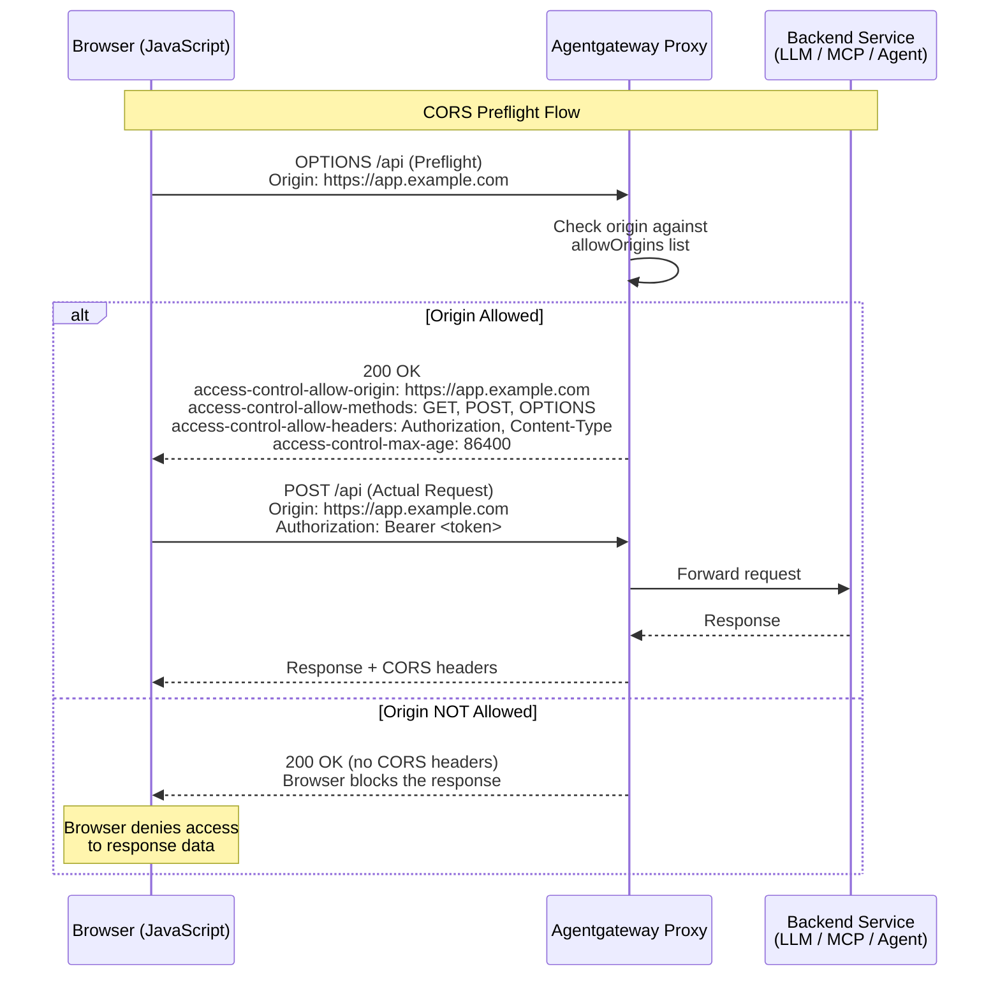

Attaches to: 



## About CORS

Cross-origin resource sharing (CORS) is a browser security mechanism which allows a server to control which origins can request and interact with resources that are hosted on a different domain. By default, web browsers only allow requests to resources that are hosted on the same domain as the web page that served the original request. Access to web pages or resources that are hosted on a different domain is restricted to prevent potential security vulnerabilities, such as cross-site request forgery (CRSF).

When CORS is enabled in a web browser and a request for a different domain comes in, the web browser checks whether this request is allowed or not. To do that, it typically sends a preflight request (HTTP `OPTIONS` method) to the server or service that serves the requested resource. The service returns the methods that are permitted to send the actual cross-origin request, such as GET, POST, etc. If the request to the different domain is allowed, the response includes CORS-specific headers that instruct the web browser how to make the cross-origin request. For example, the CORS headers typically include the origin that is allowed to access the resource, and the credentials or headers that must be included in the cross-origin request.

Review the following diagram to see an example CORS request flow: 


Note that the preflight request is optional. Web browsers can also be configured to send the cross-origin directly. However, access to the request resource is granted only if CORS headers were returned in the response. If no headers are returned during the preflight request, the web browser denies access to the resource in the other domain.

CORS policies are typically implemented to limit access to server resources for JavaScripts that are embedded in a web page, such as:

* A JavaScript on a web page at `example.com` tries to access a different domain, such as `api.com`.
* A JavaScript on a web page at `example.com` tries to access a different subdomain, such as `api.example.com`.
* A JavaScript on a web page at `example.com` tries to access a different port, such as `example.com:3001`.
* A JavaScript on a web page at `https://example.com` tries to access the resources by using a different protocol, such as `http://example.com`.

> [!TIP]
> Requests that violate the CORS policy will still have responses returned, but the browser will reject them. As such, usage of tools like `curl` with `cors` can be confusing, as `curl` does not respect CORS headers.

- `allowOrigins`
- `allowMethods`
- `allowHeaders`
- `exposeHeaders`
- `allowCredentials`
- `maxAge`

You can configure CORS in the UI or in your configuration file.


{}
The following steps add the same CORS policy as the **Simplified (LLM)** example in the **Config file** tab.

1. Create a configuration with an LLM model, but no CORS policy. You add the policy in the UI.
   ```yaml
   # yaml-language-server: $schema=https://agentgateway.dev/schema/config
   llm:
     models:
     - name: "*"
       provider: openAI
       params:
         apiKey: "$OPENAI_API_KEY"
   ```
2. Start agentgateway with this configuration.
3. Open [http://localhost:15000/ui/llm/policies](http://localhost:15000/ui/llm/policies) (**LLM** > **Policies**), and click the **CORS** tile.
4. Fill out the CORS form.
   1. In **Allowed origins**, enter `https://chat.example.com`, and click **Add**.
   2. In **Allowed methods**, select **POST** and **OPTIONS**, and clear **GET**.
   3. In **Allowed headers**, clear **Allow all request headers**. Then, in **Header allowlist**, click the `authorization` and `content-type` suggestions.
   4. In **Expose headers**, click the `x-request-id` suggestion.
   5. Select **Allow credentials**.
   6. Enter `10m` for the **Max age**.

   

   

5. Click **Save policy**.

You can also add a CORS policy in **MCP** > **Policies**, or in the **Route policies** section of a route in **Traffic** > **Routes**.

Whether the UI can save depends on your storage mode. For more information, see [Save changes from the UI]().
{}
{}


```yaml
# yaml-language-server: $schema=https://agentgateway.dev/schema/config
llm:
  policies:
    cors:
      allowOrigins:
      - https://chat.example.com
      allowMethods:
      - POST
      - OPTIONS
      allowHeaders:
      - authorization
      - content-type
      exposeHeaders:
      - x-request-id
      allowCredentials: true
      maxAge: 10m
  models:
  - name: "*"
    provider: openAI
    params:
      apiKey: "$OPENAI_API_KEY"
```


```yaml
# yaml-language-server: $schema=https://agentgateway.dev/schema/config
mcp:
  port: 3000
  policies:
    cors:
      allowOrigins:
      - https://chat.example.com
      allowMethods:
      - POST
      - OPTIONS
      allowHeaders:
      - authorization
      - content-type
      exposeHeaders:
      - x-request-id
      allowCredentials: true
      maxAge: 10m
  targets:
  - name: everything
    stdio:
      cmd: npx
      args: ["@modelcontextprotocol/server-everything"]
```


```yaml
# yaml-language-server: $schema=https://agentgateway.dev/schema/config
gateways:
  default:
    port: 3000
routes:
- backends:
  - host: api.example.com:443
  policies:
    cors:
      allowOrigins:
      - https://app.example.com
      allowMethods:
      - GET
      - POST
      - OPTIONS
      allowHeaders:
      - authorization
      - content-type
      exposeHeaders:
      - x-request-id
      allowCredentials: true
      maxAge: 100s
```


{}

