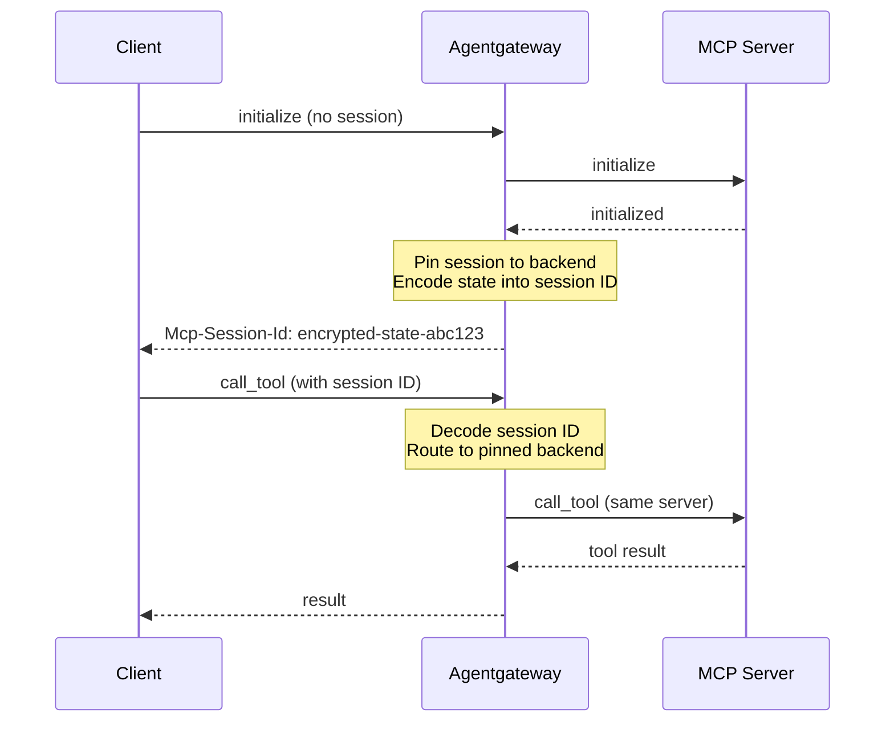

Connect to an MCP server via streamable HTTP. 



## About streamable HTTP

Agentgateway automatically manages stateful MCP sessions when using HTTP-based transports. The session state (including backend pinning) is encoded in the session ID and persisted across requests, ensuring that subsequent tool calls in the same session are routed to the same backend server. If a client reuses a session ID on a different route to the same backend, the request uses the MCP policy settings from the new route.



1. **Session initialization**: When a client sends an `initialize` request, agentgateway creates a session and returns a session ID
2. **Backend pinning**: The session is pinned to a specific backend server (important when using multiple targets)
3. **State encoding**: The session state is encoded into the session ID and encrypted with AES-256-GCM. For the key that agentgateway uses, see [Session key](#session-key).
4. **Session resumption**: Subsequent requests with the same session ID are automatically routed to the same backend. If the route changes, the MCP policy settings from the new route still apply.

If a client sends a session ID that the proxy cannot decode, the proxy returns `HTTP 404`, and the [MCP specification](https://modelcontextprotocol.io/specification/2025-11-25/basic/transports#session-management) requires the client to start a new session. A session ID cannot be decoded after the session key changes. For example, a session ID fails to decode after you restart the proxy with a different key, or when proxy instances behind one load balancer use different keys. If an encrypted session ID belongs to a different MCP backend from the current request's backend, the proxy also returns `HTTP 404`. The client starts a new session on the current backend.

When a client closes a stateful session with `DELETE /mcp`, the proxy decodes the session ID before it sends close requests to upstream targets. Any replica with the same session key can close the upstream sessions. Deletion is best effort. Upstream close failures still return `HTTP 202`, and those upstream sessions stay open until the target's idle timeout. If the proxy cannot rebuild a target connection from the session ID, the client receives the rebuild error.

Client `POST` requests to the MCP endpoint must list both `application/json` and `text/event-stream` in the `Accept` header. Clients can send the two media types as one comma-separated value or as separate `Accept` header lines. If either media type is missing, the request fails with HTTP 406.

### Session key {#session-key}

Agentgateway encrypts session IDs with an AES-256-GCM key, which is 32 random bytes encoded as 64 hexadecimal characters. Agentgateway uses the first key that it finds in the following order.

1. The `SESSION_KEY` environment variable.
2. The `config.session.key` field in your configuration file.
3. A key that agentgateway generates at startup, if it has a writable place to save the key. Where agentgateway saves the key depends on the [storage mode]().
   * In `hybrid` mode, agentgateway stores the key in the database. Every instance that shares the database uses the same key.
   * In `file` mode, agentgateway writes the key to the `config.session.key` field of your configuration file, and reads it from there on the next start. The generated entry looks like the following example.

     ```yaml
     config:
       session:
         # Auto-generated by agentgateway to encode session IDs. Changing it invalidates existing sessions.
         key: 5dbc5a7ac4111369ccfb9c0d94273079033d0d40c6cb4d1a114a0e813a051b7f
     ```

If agentgateway has nowhere to save a generated key, it leaves session IDs unencrypted and logs a warning at startup. This happens in the following cases.

* You use `readOnly` storage mode.
* Agentgateway cannot write to the configuration file, such as a read-only Docker mount or the ConfigMap of a [Helm installation]().
* You pass the configuration inline with `--config`.

An unencrypted session ID is only base64-encoded, so a client can read the target names and upstream session IDs in it.

```txt
no session key configured; MCP session IDs are not encrypted. Set SESSION_KEY or config.session.key
```

To set your own key, generate one and pass it in the `SESSION_KEY` environment variable. Set your own key when you keep your configuration file in version control, so that agentgateway does not write a secret into it. Also set your own key when more than one agentgateway instance serves the same clients without a shared database, so that every instance can decode the session IDs that the others issue.

```sh
export SESSION_KEY=$(openssl rand -hex 32)
```

To leave session IDs unencrypted on purpose and stop the warning, set `SESSION_KEY` or `config.session.key` to `disabled`.

## Stateless sessions {#stateless-sessions}

By default, agentgateway proxies streamable HTTP in **stateful** mode, as described in the previous section. You can instead run in **stateless** mode with the `statefulMode` field, so that agentgateway does not create a session or return an `Mcp-Session-Id` header. Each request is treated independently, and the client must send the full context that the request needs. This mode suits stateless agents, or MCP servers where the client handles state directly.

> [!NOTE]
> The `statefulMode` field controls how agentgateway proxies session-based servers. It is separate from the newer, inherently sessionless `2026-07-28` MCP protocol, which agentgateway supports automatically through version negotiation. For more information, see [MCP spec compatibility]().

You can turn on stateless mode in the UI or in your configuration file.


{}
These steps assume an MCP server that you already added, as described in [Configure the agentgateway](#configure-the-agentgateway).

1. Open [http://localhost:15000/ui/mcp/servers](http://localhost:15000/ui/mcp/servers) (**MCP** > **Servers**), and click **Settings**.
2. For **State mode**, select **Stateless**.

   

3. Click **Save settings**.

The UI sets `statefulMode` to `stateless`, as in the **Config file** tab. It also sets `failureMode` to `failClosed` and writes an empty `gateways` list.

> [!NOTE]
> When `statefulMode` is not set, the **State mode** list still shows **Stateless**, although the default is stateful. If you save the **Settings** drawer to change another field, select **Stateful** first to keep the default session behavior.

Whether the UI can save depends on your storage mode. For more information, see [Save changes from the UI]().
{}
{}
Set `statefulMode` to `stateless` on the MCP configuration.

```yaml
# yaml-language-server: $schema=https://agentgateway.dev/schema/config
mcp:
  port: 3000
  statefulMode: stateless
  targets:
  - name: mcp
    mcp:
      host: http://localhost:3005/mcp/
```
{}


When you send an `initialize` request through agentgateway in stateless mode, the response returns `HTTP 200` with no `Mcp-Session-Id` header. In the default stateful mode, the same request returns an `Mcp-Session-Id` header that pins the session to a backend.


# WHAT THIS TEST VALIDATES:
#   * statefulMode: stateless is accepted and the MCP endpoint serves an initialize request (HTTP 200)
#   * In stateless mode, the initialize response does NOT include an Mcp-Session-Id header
# WHAT THIS TEST DOES NOT VALIDATE (and why):
#   * The visible example uses a streamable HTTP upstream (host: http://localhost:3005/mcp/);
#     the hidden test config uses a self-contained stdio target so no external MCP server is
#     needed. statefulMode governs the downstream (client-facing) session, independent of the
#     upstream transport, so the stateless behavior under test is the same.
#   * The default stateful contrast (Mcp-Session-Id present) is covered by other pages that
#     use the default configuration.



# Install agentgateway binary




cat <<'EOF' > config.yaml
# yaml-language-server: $schema=https://agentgateway.dev/schema/config
mcp:
  port: 3000
  statefulMode: stateless
  targets:
  - name: everything
    stdio:
      cmd: npx
      args: ["@modelcontextprotocol/server-everything"]
EOF



agentgateway -f config.yaml &
AGW_PID=$!
trap 'kill $AGW_PID 2>/dev/null' EXIT
sleep 3



YAMLTest -f - <<'EOF'
- name: MCP endpoint accepts initialize request in stateless mode
  http:
    url: "http://localhost:3000"
    path: /mcp
    method: POST
    headers:
      content-type: application/json
      accept: "application/json, text/event-stream"
    body: |
      {"jsonrpc":"2.0","method":"initialize","params":{"protocolVersion":"2024-11-05","capabilities":{},"clientInfo":{"name":"test","version":"1.0"}},"id":1}
  source:
    type: local
  expect:
    statusCode: 200
EOF



# Assert that stateless mode does not return an Mcp-Session-Id header
if curl -sS -D - -o /dev/null -X POST http://localhost:3000/mcp/ \
  -H 'Content-Type: application/json' \
  -H 'Accept: application/json, text/event-stream' \
  -d '{"jsonrpc":"2.0","method":"initialize","params":{"protocolVersion":"2024-11-05","capabilities":{},"clientInfo":{"name":"test","version":"1.0"}},"id":1}' \
  | grep -qi 'mcp-session-id'; then
  echo "FAIL: stateless mode returned an Mcp-Session-Id header"
  exit 1
fi
echo "PASS: no Mcp-Session-Id header in stateless mode"


## Request body limits {#mcp-request-body-limits}

The MCP listener applies the gateway HTTP body buffer limit to JSON-RPC request bodies from streamable HTTP and legacy Server-Sent Events (SSE) POST requests. If a request body exceeds the configured limit, the client receives HTTP 413 and a response body that includes the configured byte limit. Malformed JSON that stays within the limit receives HTTP 400.

## DNS rebinding protection {#dns-rebinding}

A browser page on any origin can resolve a hostname it controls to `127.0.0.1` and then send requests to a locally bound server. This is a DNS rebinding attack, and it is why the MCP specification requires a server that listens on localhost to reject a `Host` or `Origin` header that does not name a loopback address.

Agentgateway is usually a proxy in front of other servers rather than a browser-facing localhost server, so this check is off by default. Turn it on with `dnsRebindingProtection` when you run agentgateway on a developer machine and a browser can reach the MCP port.

```yaml
# yaml-language-server: $schema=https://agentgateway.dev/schema/config
mcp:
  port: 3000
  dnsRebindingProtection: true
  targets:
  - name: mcp
    mcp:
      host: http://localhost:3005/mcp/
```

When the check is on, agentgateway applies the following rules.

| Rule | Behavior |
| -- | -- |
| Host must be loopback | The request authority must be `localhost`, `127.0.0.1`, or `[::1]`. A port is allowed. |
| Origin must be loopback | If the request carries an `Origin` header, it must name one of the same three hosts. |
| A missing Origin is allowed | A non-browser client and a same-origin request often omit the header, so agentgateway accepts a request that has no `Origin`. |
| A duplicate Origin is rejected | `Origin` is a singleton header. Agentgateway rejects a request that carries more than one, rather than validating only the first. |

A request that fails any rule receives a `403` response with the body `MCP DNS rebinding protection: Host/Origin must be localhost, 127.0.0.1, or [::1]`.

> [!WARNING]
> Do not turn this on for an agentgateway that serves MCP to clients over the network. Every request from a remote client names a non-loopback host, so agentgateway rejects all of them.

## Before you begin



## Configure the agentgateway

Spin up an MCP server that uses streamable HTTP.

```sh
PORT=3005 npx -y @modelcontextprotocol/server-everything streamableHttp
```

Then, connect agentgateway to your MCP server. You can use the UI or a configuration file.


{}
1. Create a configuration with an empty `mcp` section, and start agentgateway. You add the MCP server and the CORS policy in the UI.
   ```sh
   cat <<'EOF' > config.yaml
   # yaml-language-server: $schema=https://agentgateway.dev/schema/config
   mcp:
     port: 3000
     targets: []
   EOF
   agentgateway -f config.yaml
   ```
2. Open [http://localhost:15000/ui/mcp/servers](http://localhost:15000/ui/mcp/servers) (**MCP** > **Servers**), and click **Add server**.
3. Enter `mcp` for the **Server name**, and keep the **Streamable HTTP** transport.
4. Enter `http://localhost:3005/mcp/` for the **URL**, and click **Save server**.

   

5. Open **MCP** > **Policies**, and click **CORS**. Expose the `Mcp-Session-Id` header so that clients keep their session.
   1. In **Allowed origins**, enter `*`, and click **Add**.
   2. Keep **Allow all request headers** selected.
   3. In **Expose headers**, enter `Mcp-Session-Id`, and click **Add**.

      

   4. Click **Save policy**.

The UI writes the same `mcp` section as the **Config file** tab, with two additions. The CORS policy also lists the selected **Allowed methods**, `GET` and `POST`. The first save also adds a generated session key, `config.session.key`.

Instead of step 5, you can click **Apply CORS** in the **Tool Playground**. That shortcut allows the origin of the UI instead of `*`.
{}
{}
1. Create a configuration for your agentgateway to connect to your MCP server. Make sure to expose the `Mcp-Session-Id` header in the CORS configuration for session persistence.
   ```yaml
   cat <<EOF > config.yaml
   # yaml-language-server: $schema=https://agentgateway.dev/schema/config
   mcp:
     port: 3000
     policies:
       cors:
         allowOrigins:
           - "*"
         allowHeaders:
           - "*"
         exposeHeaders:
           - "Mcp-Session-Id"
     targets:
     - name: mcp
       mcp:
         host: http://localhost:3005/mcp/
   EOF
   ```

2. Run the agentgateway. 
   ```sh
   agentgateway -f config.yaml
   ```
{}


## Verify access to tools

1. Open the [agentgateway UI](http://localhost:15000/ui/) to view your listener and backend configuration.

2. Connect to the MCP test server with the agentgateway UI playground.

   1. From the navigation menu under **MCP**, click **Tool Playground**.
   2. If you see a **Browser access is not allowed** notice, click **Apply CORS** so the playground can call the MCP listener from the UI.
   3. Click **Initialize** to open an MCP session. The agentgateway UI connects to the target that you configured and lists the tools that are exposed on the target.

      
      

3. Verify access to a tool.
   1. From the **Tool** list, select the `echo` tool.
   2. In the **Message** field, enter any string, such as `This is my first agentgateway setup.`, and click **Call tool**.
   3. Verify that the **Result** card shows an `HTTP 200` response with your message echoed back.

      
      
